# NYC Taxi Demand and Fare Forecasting on AWS: End-to-End MLOps with XGBoost, LightGBM, MLflow, FastAPI, Streamlit, Amazon SageMaker, ECS Fargate, CloudFront and Terraform

[](https://github.com/anandapurva55/nyc-taxi-forecasting/actions/workflows/ci.yml)


An end-to-end **MLOps** system on AWS, written in **Python**, that forecasts hourly taxi pickups across 254 New York City zones and quotes trip fares, built from 3 million NYC TLC trip records processed with **pandas**, **NumPy** and **PyArrow**.

**XGBoost** and **LightGBM** regressors, built on **scikit-learn** and tuned with **Optuna**, forecast pickups per zone and price trips, with a separate booking-time model for quotes made before the trip. Each is benchmarked against simple baselines with bootstrap confidence intervals and versioned in the **MLflow** registry, which saves newly trained models in the safe **skops** format. A **FastAPI** service with **Pydantic** validation and **Prometheus** metrics runs on **Amazon ECS Fargate** behind an **Application Load Balancer** and serves the models over HTTPS through **Amazon CloudFront**, using the model for the next two hours of demand and last week's count after that. Its API key is kept in **AWS Systems Manager Parameter Store**, and each service runs under its own **AWS IAM** role. A **Streamlit** and **Plotly** web app lets people explore forecasts, fares and **SHAP** explanations. **GitHub Actions** and **AWS CodeBuild** test every change and push commit-tagged **Docker** images to **Amazon ECR**; dependencies are locked with **uv**, audited with **pip-audit** and kept current by **Dependabot**; and all 66 AWS resources are defined in **Terraform**. Every prediction flows through **CloudWatch Logs** and **Amazon Data Firehose** into **Amazon S3**, where **Amazon SageMaker Processing** jobs started by **Amazon EventBridge Scheduler** check for drift and score live demand accuracy against actual pickups, raising **CloudWatch** alarms through **Amazon SNS**. Fairness reports are published to a versioned S3 data lake catalogued for **AWS Glue** and **Amazon Athena**, and a **SageMaker Pipelines** definition sets out gated retraining.

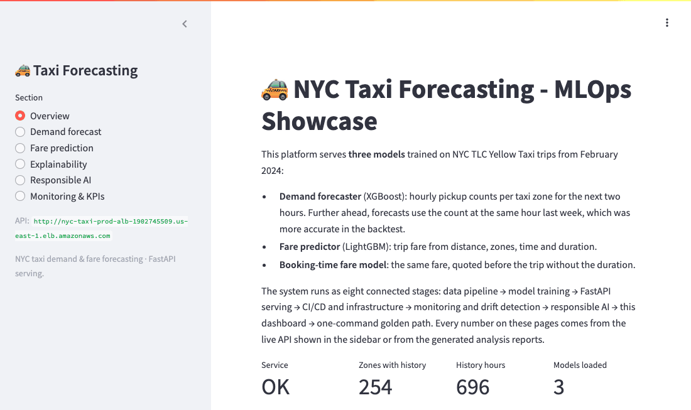

| **0.962** | **0.968** | **14 ms** | **373 ms** | **66** | **181** |
|:---:|:---:|:---:|:---:|:---:|:---:|
| Fare model R² | Demand model R² | Median server latency | p95 end-to-end latency over HTTPS | AWS resources in Terraform | Automated tests |

---

## Contents

1. [Results at a glance](#results-at-a-glance)
2. [Tech stack](#tech-stack)
3. [Architecture](#architecture)
4. [Engineering decisions](#engineering-decisions)
5. [Dataset](#dataset)
6. [Quick start](#quick-start)
7. [Data pipeline](#data-pipeline)
8. [Model training and registry](#model-training-and-registry)
9. [Evaluation beyond one test score](#evaluation-beyond-one-test-score)
10. [Real-time API and batch inference](#real-time-api-and-batch-inference)
11. [CI/CD and infrastructure on AWS](#cicd-and-infrastructure-on-aws)
12. [Monitoring: drift and live accuracy](#monitoring-drift-and-live-accuracy)
13. [Responsible AI](#responsible-ai)
14. [Streamlit web app](#streamlit-web-app)
15. [Reproducible golden path](#reproducible-golden-path)
16. [Issues found and fixed](#issues-found-and-fixed)
17. [Security](#security)
18. [Cost](#cost)
19. [What I would build next](#what-i-would-build-next)
20. [Limitations](#limitations)
21. [Repository layout](#repository-layout)

---

## Results at a glance

Models are tuned on a holdout cut from the end of the training period, selected on the **validation** set and reported on the **test** set, which neither step sees. Every test score has a 95% block-bootstrap confidence interval and sits next to the simple rule it has to beat. Data: NYC Yellow Taxi, February 2024.

| Model | Predicts | Test RMSE (95% CI) | Test R² | Best simple rule |
|---|---|---|---|---|
| Demand (XGBoost) | Pickups per zone in the next hour | **11.36** (9.76 to 13.05) | 0.968 | Same hour last week: 15.81 |
| Fare (LightGBM) | `fare_amount` when the trip duration is known | **$3.21** ($3.00 to $3.43) | 0.962 | Linear on distance and duration: $4.89 |
| Booking-time fare (LightGBM) | `fare_amount` quoted before the trip | **$3.98** ($3.75 to $4.19) | 0.942 | Fare model with an estimated duration: $4.35 |

| Area | Outcome |
|---|---|
| Data | 3,007,526 raw trips: 3,007,511 valid pickups feed demand, 2,722,931 clean trips (90.5%) feed fares |
| Multi-hour demand | Over 57 forecast origins, the model wins 1 hour ahead (10.35 against 13.39); from 3 hours ahead the same hour last week is as good or better, so the API switches to it. The served forecast scores 13.81 against 14.77 for the model alone |
| Backtests | Both models beat their baseline in all 3 rolling folds: demand 11.65 ± 3.14 against 13.35, fare $3.49 ± 0.11 against $4.80 |
| Quality gate | Ruff clean, 181 tests passing, 92% line coverage, run by GitHub Actions and CodeBuild |
| Supply chain | 257 locked packages, hash-checked by uv, 0 known vulnerabilities (pip-audit blocks the build otherwise); Dependabot opens weekly update pull requests |
| Infrastructure | 66 AWS resources from Terraform; API and web app ran 1 of 1 tasks behind CloudFront |
| Checks on AWS | 10 of 10 smoke checks and 400 of 400 load-test requests passed over HTTPS; plain HTTP is refused and the load balancers cannot be reached directly; requests without the API key returned 401; a caller rotating a fake `X-Forwarded-For` on every request was still cut off at the rate limit |
| Latency | 14 ms median server time; p95 373 ms (fare) and 349 ms (demand) end to end over HTTPS |
| Live accuracy | 500 served demand predictions matched to actual pickups built automatically from the TLC file: RMSE 13.53 against the 11.36 test baseline, within the 20% tolerance |
| Drift | A three-day window of real traffic no longer raises false alarms: `day_of_week` went from PSI 8.17 to 0.005 after window matching, and zone noise in a 500-request sample is no longer flagged |
| Responsible AI | WAPE-based subgroup audit of all three models; unknown pickup zones are flagged `low_confidence` in API responses |
| Reproducibility | One command takes a new, empty copy of the repository to trained, evaluated, served and audited models: 13 of 13 stages in 15 min 2 s |

---

## Tech stack

| Area | Tools |
|---|---|
| Language | Python 3.11 |
| Data processing | pandas, NumPy, Parquet (PyArrow), `holidays` (US public holidays) |
| Modelling | XGBoost, LightGBM, scikit-learn |
| Hyperparameter tuning | Optuna |
| Experiment tracking and model registry | MLflow 3 on SQLite, skops (safe model serialization) |
| Evaluation | Block bootstrap confidence intervals, rolling-origin backtests, naive forecasting baselines |
| Explainability and drift | SHAP, Matplotlib, Population Stability Index, Kolmogorov-Smirnov and chi-square tests (SciPy), Evidently (optional HTML reports) |
| Serving | FastAPI, Pydantic, Uvicorn, Prometheus instrumentation, SQLite (batch forecasts) |
| Web app | Streamlit, Plotly |
| Configuration | YAML (PyYAML), environment overrides (python-dotenv) |
| Packaging | uv (hash-checked lockfile), Docker (multi-stage builds, non-root user), Docker Compose |
| Infrastructure as code | Terraform |
| Compute and networking | Amazon ECS on Fargate, Application Load Balancer, Amazon CloudFront (HTTPS), Amazon VPC |
| Delivery | GitHub Actions, Dependabot, GitHub webhooks, AWS CodeBuild, Amazon ECR |
| Monitoring | Amazon CloudWatch Logs, metrics, alarms and dashboard, Amazon Data Firehose, Amazon SNS |
| ML operations | Amazon SageMaker Processing, SageMaker Pipelines (gated retraining definition), Amazon EventBridge Scheduler, boto3, SageMaker Python SDK |
| Storage and analytics | Amazon S3 with versioning, AWS Glue Data Catalog, Amazon Athena |
| Security | AWS IAM (one role per service), AWS Systems Manager Parameter Store, VPC security groups, Amazon ECR image scanning |
| Operations | AWS Resource Groups (every resource tagged and listed in one group) |
| Quality | pytest with coverage, Ruff, pip-audit |
| Notebooks and docs | Jupyter, `diagrams` with Graphviz (architecture diagrams generated from code) |

---

## Architecture

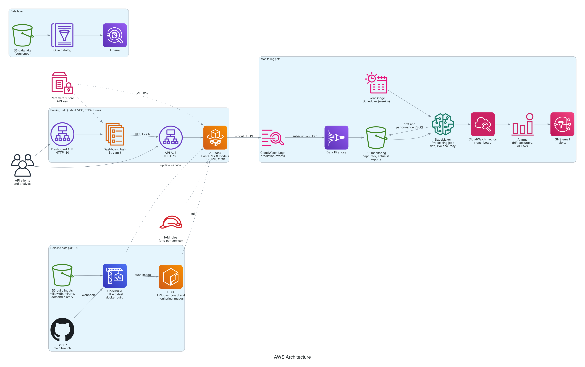

The system is split into three paths, each with one job:

| Path | Question it answers | Services |
|---|---|---|
| **Serving** | Who answers the customer? | CloudFront (HTTPS) → Application Load Balancer → ECS service → Fargate task running FastAPI with all three models in memory |
| **Release** | Who ships a change? | GitHub Actions and a CodeBuild webhook (lint, tests) → Docker build → ECR → ECS rolling update |
| **Evidence** | Who records what happened? | CloudWatch Logs → Data Firehose → S3 → SageMaker Processing (drift and live accuracy) → CloudWatch metrics and alarms → SNS email |

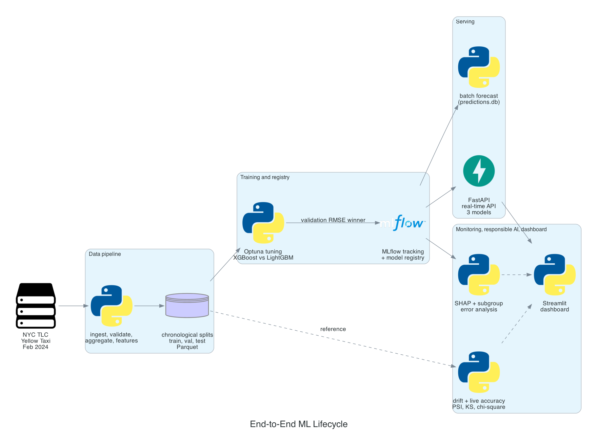

All diagrams are generated from code in [docs/diagrams/generate.py](docs/diagrams/generate.py) with the [`diagrams`](https://diagrams.mingrammer.com) library and the official AWS icon set.

---

## Engineering decisions

**Beat a simple rule before claiming skill.** Every model is scored next to the naive rule a planner would use without it: the same hour last week for demand, a linear fit on distance for fares. A low RMSE on its own says nothing about whether the model is worth running.

**Serve the model only where it wins.** The API forecasts up to 24 hours ahead by feeding each predicted hour back in as the next hour's input. A 57-origin backtest showed those errors compound: the model is clearly better 1 hour ahead, but from 3 hours ahead the count at the same hour last week is as good or better. The API therefore uses the model for the next 2 hours and the weekly rule after that, and every forecast point reports which `method` produced it.

**Train for the inputs the caller really has.** The fare model uses the trip duration, which only exists after the trip. Quoting a fare before the trip by guessing the duration cost accuracy: $6.14 RMSE with a fixed 3 minutes per mile, $4.35 with a learned estimate. A separate booking-time model trained without the duration scores $3.98, and the API picks the model that matches the request.

**Tune, select and test on separate data.** **Optuna** tunes each candidate on the last 15% of the training period, so the validation set is used only to choose between **XGBoost** and **LightGBM**. A paired bootstrap interval on the validation difference records whether the choice is clear: it is for both fare models, and it is not for demand, where the two candidates are within 0.04 RMSE (interval −0.29 to 0.19). The winner is then refit on training and validation data and scored once on test.

**Split by time, not at random.** Demand features include lags of 1 hour to 1 week. A random split would let the model learn from hours that come after the ones it is tested on. Training uses the first 80% of February, validation the next 10% and test the final 10%.

**Bake the models into the image and pin them.** Each API image contains the code, the registered models, a portable copy of the **MLflow** registry and the demand history, and is tagged with the commit it was built from. Serving loads the `champion` alias, resolves it to an exact model version, and reports those versions with hashes of the baked inputs at `/version`. A rollback is a redeploy of an earlier tag.

**Capture predictions through logs, not in the request path.** The API writes one JSON line per prediction to standard output. **CloudWatch Logs**, a subscription filter and **Firehose** deliver those lines to S3. This adds no latency to requests and no extra dependency to the API, and predictions keep flowing even if the monitoring pipeline is down.

**Watch accuracy, not only inputs.** Drift says the data changed, not that the model got worse. A second scheduled job joins captured demand predictions to the actual pickup counts once they are published and compares live error with the model's test baseline.

**Compare subgroups on relative error.** Raw RMSE grows with volume, so busy Manhattan always looked "worst". The audit compares groups on WAPE (total absolute error over total actual) and leaves out groups with almost no volume, where WAPE is unstable.

**Make drift alarms honest about sample size.** Two drift checks raised false alarms on real traffic. Hour and day of week depend on when traffic was captured, so a three-day window always looked shifted; they are now compared with the hours inside the capture window. Category PSI is biased upward on small samples: in 20 random 500-trip samples with no drift, it crossed 0.2 six times. A category feature now drifts only when the change is both large (PSI) and statistically significant (chi-square, Bonferroni-corrected), which brought false alarms to 0 in 40 trials while still catching a 10% shift.

**Lock dependencies and audit every build.** A scan of the original pinned packages found 191 known vulnerabilities, including 81 in MLflow. **uv** now resolves every dependency group into one hash-checked lockfile, CI fails if the lockfile is stale or any locked package has a known vulnerability, and Dependabot proposes updates weekly. The upgrade to MLflow 3 kept every registered model: all three return identical predictions on 5,000 test rows each.

**Treat an alarm as the start of an investigation.** Alarms email a person. Nothing retrains or redeploys automatically, because a new model must pass the same evaluation and quality gate as the current one before it ships.

---

## Dataset

| Item | Detail |
|---|---|
| Source | [NYC Taxi and Limousine Commission trip records](https://www.nyc.gov/site/tlc/about/tlc-trip-record-data.page) |
| File | `yellow_tripdata_2024-02.parquet`: 3,007,526 trips, 19 columns |
| Zone lookup | `taxi_zone_lookup.csv`: 265 zones with borough and service zone |
| Key columns | pickup and drop-off timestamps, pickup and drop-off zone IDs, trip distance, passenger count, fare amount |
| Configuration | `tlc_year: 2024`, `tlc_month: 2` in [config/config.yaml](config/config.yaml) |

| Stage | One row is |
|---|---|
| Raw trips | one taxi trip |
| Demand table | one pickup zone in one hour, including hours with zero pickups |
| Fare table | one clean trip with its engineered features |

The data has no rider names or demographic fields. Zones and boroughs are geographic groups, not personal attributes. Full scope and limits are in [docs/DATA_STATEMENT.md](docs/DATA_STATEMENT.md).

---

## Quick start

Requirements: [**uv**](https://docs.astral.sh/uv/getting-started/installation/), which also installs **Python** 3.11 when it is missing, Git and, on macOS, `brew install libomp` for **XGBoost** and **LightGBM**.

```bash
git clone https://github.com/anandapurva55/nyc-taxi-forecasting.git
cd nyc-taxi-forecasting
bash scripts/golden_path.sh
```

This one command builds the environment from `uv.lock` (`uv sync --frozen`), runs lint and tests, downloads and processes the data, trains and registers all three models, evaluates them against baselines, runs batch inference, starts the API and checks every endpoint, and produces the responsible AI and drift reports. See [Reproducible golden path](#reproducible-golden-path) for the result. On Windows, run each command from the sections below with `.\.venv\Scripts\python.exe` in place of `.venv/bin/python`.

---

## Data pipeline

Ingests the NYC TLC Yellow Taxi **Parquet** file for February 2024, enforces a schema and plausibility rules, builds a dense zone-by-hour demand table from every valid pickup, engineers leakage-safe lag, rolling and airport features, and writes chronological train, validation and test splits as Parquet with a JSON audit of every dropped row.

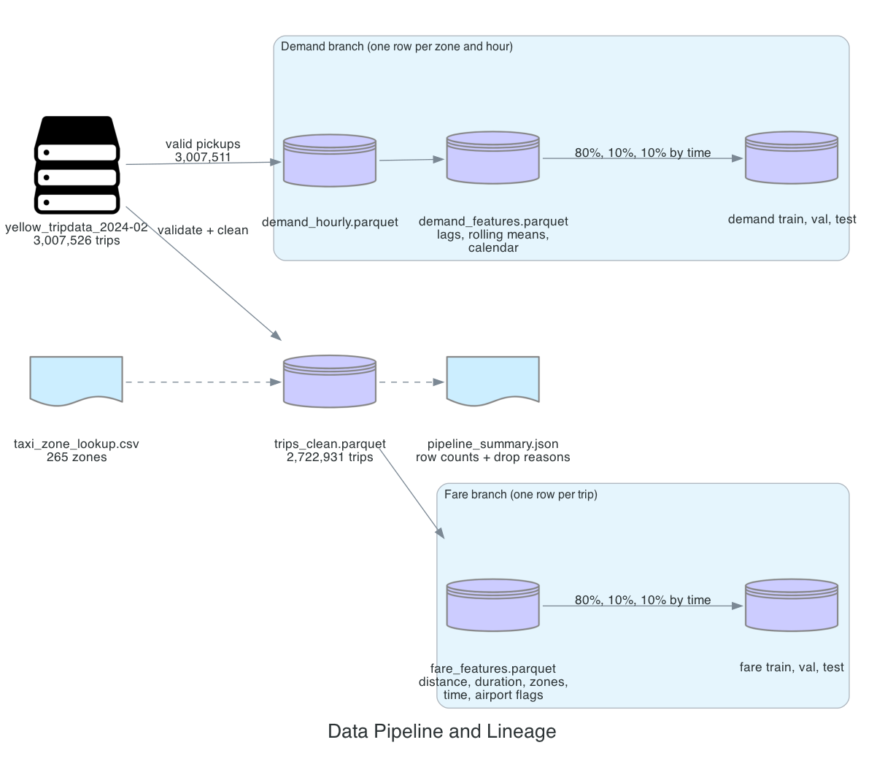

1. **Ingest** ([src/data/ingestion.py](src/data/ingestion.py)) downloads the monthly **Parquet** file and the zone lookup into `data/raw/`.
2. **Select pickups for demand** ([src/data/validation.py](src/data/validation.py)). Every trip with a valid pickup time and zone in February counts as a pickup, including trips whose fare or passenger count is implausible.
3. **Clean trips for fares** with the bounds in `config/config.yaml`: duration, distance, fare and passenger count.
4. **Aggregate** ([src/data/aggregation.py](src/data/aggregation.py)) pickups into a dense zone-by-hour table of counts.
5. **Engineer features** ([src/features/](src/features/)). Demand gets calendar features, lags of 1, 2, 3, 24 and 168 hours and rolling statistics over 3, 24 and 168 hours, all shifted so only past values are used. Fare gets trip distance, trip duration, passenger count, pickup and drop-off zones, pickup time and two airport flags: any airport trip, and JFK to Manhattan, which has a flat fare.
6. **Split by time** ([src/data/splits.py](src/data/splits.py)) into 80% training, 10% validation and 10% test.
7. **Persist evidence.** Every output is **Parquet**, and `data/processed/pipeline_summary.json` records row counts and drop reasons for both branches.

**Commands**

```bash
.venv/bin/python -m scripts.run_pipeline --year 2024 --month 2
```

**Results.** 3,007,526 trips in. Demand keeps 3,007,511 pickups (15 fall outside February). Fares keep 2,722,931 clean trips, and 284,595 are removed, each with a recorded reason.

<details>
<summary>Pipeline audit: <code>data/processed/pipeline_summary.json</code> (click here to expand)</summary>

```json
{
  "year": 2024,
  "month": 2,
  "cleaning": {
    "input_rows": 3007526,
    "output_rows": 2722931,
    "total_dropped": 284595,
    "dropped": {
      "outside_target_period": 15,
      "trip_duration_out_of_range": 35545,
      "trip_distance_out_of_range": 70,
      "fare_out_of_range": 35776,
      "passenger_count_out_of_range": 213189
    }
  },
  "demand_pickups": {
    "input_rows": 3007526,
    "output_rows": 3007511,
    "total_dropped": 15,
    "dropped": {
      "outside_target_period": 15
    }
  },
  "demand_feature_rows": 134112,
  "fare_feature_rows": 2722931
}
```

</details>

A visual walk-through of the raw data, every cleaning rule and both feature branches is in [notebooks/01_explore_dataset.ipynb](notebooks/01_explore_dataset.ipynb).

---

## Model training and registry

Runs **Optuna** hyperparameter search for **XGBoost** and **LightGBM** on each of the three problems, logs every candidate to **MLflow** on a SQLite backend, selects the winner on validation data with a bootstrap check on the margin, refits it on training and validation data, and registers it in the **MLflow Model Registry** under the `champion` alias.

1. **Optuna** runs 25 trials per candidate over the number of trees, tree depth, learning rate, row and column sampling, minimum leaf size and L2 regularisation ([src/models/tuning.py](src/models/tuning.py)). Trials are scored on the last 15% of the training period, never on validation data.
2. Each tuned candidate is fitted on the full training split and scored on validation. A paired block bootstrap on the validation difference ([src/models/uncertainty.py](src/models/uncertainty.py)) records whether the winner is clearly better.
3. The winner is refitted on training and validation data and scored once on test, with a 95% block-bootstrap interval resampled by hour.
4. The final model is saved in MLflow's **skops** format, which loads only types the project explicitly trusts (XGBoost, LightGBM, scikit-learn and NumPy), and registered as `taxi-demand-forecaster`, `taxi-fare-predictor` or `taxi-fare-booking`. The `champion` alias is moved to it, and its test metrics are written to [config/performance_baseline.json](config/performance_baseline.json) for live monitoring. SHAP plots and a model card are logged with it.

**Commands**

```bash
.venv/bin/python -m scripts.train_models
.venv/bin/python -m mlflow ui --backend-store-uri sqlite:///mlflow.db --host 127.0.0.1 --port 5050
```

**Results**

| Problem | Candidate | Tuning RMSE | Validation RMSE | Selection | Test RMSE (95% CI) | Registered |
|---|---|---|---|---|---|---|
| Demand | XGBoost | 9.157 | **12.128** | winner, not clear (−0.04, interval −0.29 to 0.19) | 11.364 (9.759 to 13.048) | `taxi-demand-forecaster` v2 |
| Demand | LightGBM | 9.118 | 12.169 | | | |
| Fare | LightGBM | 3.250 | **3.670** | clear winner (−0.17, interval −0.24 to −0.11) | 3.213 (3.004 to 3.429) | `taxi-fare-predictor` v2 |
| Fare | XGBoost | 3.404 | 3.841 | | | |
| Booking-time fare | LightGBM | 3.974 | **4.456** | clear winner (−0.28, interval −0.40 to −0.19) | 3.977 (3.754 to 4.187) | `taxi-fare-booking` v1 |
| Booking-time fare | XGBoost | 4.181 | 4.739 | | | |

The demand candidates are statistically tied on validation. XGBoost is registered because the rule is fixed before training, and the tie is recorded in MLflow rather than resolved by looking at test results.

---

## Evaluation beyond one test score

[scripts/evaluate_forecasts.py](scripts/evaluate_forecasts.py) scores the registered models the way they are used, and writes everything to `artifacts/evaluation/evaluation.json`.

```bash
.venv/bin/python -m scripts.evaluate_forecasts
```

**Against naive baselines** (test split, one hour ahead, 95% block-bootstrap intervals):

| Demand | RMSE (95% CI) | | Fare | RMSE (95% CI) |
|---|---|---|---|---|
| **Model** | **11.36** (9.76 to 13.05) | | **Model** | **$3.21** ($3.00 to $3.43) |
| Same hour last week | 15.81 (11.97 to 19.77) | | Linear: distance and duration | $4.89 ($4.58 to $5.20) |
| Last hour (persistence) | 19.34 (16.62 to 21.83) | | Linear: distance only | $5.37 ($5.06 to $5.64) |
| Same hour yesterday | 21.08 (15.54 to 26.23) | | | |

**Several hours ahead.** The demand configuration is refitted on data before 22 February and started at 57 origins, every 3 hours from 22 to 29 February, running the API's real recursive forecaster at each. "Served" is what the API returns: the model for 2 hours, then the same hour last week.

| Hours ahead | Model only | **Served** | Same hour last week | Model minus last week (95% CI) |
|---|---|---|---|---|
| 1 | 10.35 | **10.35** | 13.39 | −3.04 (−4.09 to −1.84) |
| 2 | 13.34 | **13.34** | 14.23 | −0.89 (−2.02 to 0.42) |
| 3 | 14.11 | **13.99** | 13.99 | 0.12 (−0.65 to 1.10) |
| 6 | 14.84 | **14.00** | 14.00 | 0.83 (0.14 to 1.66) |
| 12 | 15.18 | **13.97** | 13.97 | 1.21 (0.24 to 2.13) |
| 24 | 15.59 | **14.33** | 14.33 | 1.26 (0.29 to 2.28) |
| **All 1 to 24** | 14.77 | **13.81** | 13.96 | 0.82 (0.45 to 1.20) |

Two other approaches were tested on the same week and dropped: a direct model that takes the horizon as an input (14.78 overall) and a model that learns a correction to last week's count (14.85).

**Quoting a fare before the trip** (test split):

| How the fare is quoted | RMSE (95% CI) | R² |
|---|---|---|
| Fare model, actual duration (known only after the trip) | $3.21 ($3.00 to $3.43) | 0.962 |
| **Booking-time model, no duration** | **$3.98 ($3.75 to $4.19)** | **0.942** |
| Fare model, duration from a learned lookup by hour and distance | $4.35 ($4.12 to $4.55) | 0.931 |
| Fare model, duration fixed at 3 minutes per mile | $6.14 ($5.90 to $6.35) | 0.861 |

**Rolling-origin backtest.** The winning configuration is refitted at three cut-offs and scored on the following 3 days:

| Cut-off | Demand model | Same hour last week | Fare model | Linear baseline |
|---|---|---|---|---|
| 15 Feb | 9.97 | 10.72 | $3.46 | $4.85 |
| 19 Feb | 15.28 | 18.21 | $3.61 | $4.87 |
| 23 Feb | 9.70 | 11.11 | $3.41 | $4.69 |
| **Mean ± std** | **11.65 ± 3.14** | 13.35 | **$3.49 ± 0.11** | $4.80 |

---

## Real-time API and batch inference

Serves three models through a **FastAPI** REST service with **Pydantic** request validation, API key authentication, per-client rate limiting, **SHAP** explanations, **Prometheus** metrics, a readiness probe and a provenance endpoint, and writes multi-hour demand forecasts in batch.

The **FastAPI** app ([src/serving/api.py](src/serving/api.py)) loads the `champion` version of each model and the demand history once at startup and answers from memory. **Pydantic** schemas ([src/serving/schemas.py](src/serving/schemas.py)) validate every request, so bad input returns HTTP 422 with the field and rule that failed.

- **Fares** are answered by the booking-time model when no `trip_duration_min` is sent, and by the fare model when it is. The response names the model that answered. Trips with an unknown zone (264 or 265) are marked `low_confidence` with a reason.
- **Demand** is forecast by the model for 2 hours past the latest observed hour and by the same hour last week after that. Every forecast point reports its `method`.

| Method | Path | Purpose |
|---|---|---|
| GET | `/health` | Readiness: model flags, history hours and zone count (no key needed) |
| GET | `/version` | Build commit, exact model versions and run IDs, input file hashes |
| POST | `/predict/fare` | Fare for one trip |
| POST | `/predict/demand` | Pickups for one zone and hour |
| POST | `/forecast/demand` | Multi-hour forecast for many zones |
| POST | `/explain/fare` | SHAP contributions for one fare prediction |
| POST | `/explain/demand` | SHAP contributions for one demand prediction |
| GET | `/metrics` | Prometheus metrics |
| GET | `/docs` | Swagger UI, with an Authorize button for the API key |

**Commands**

```bash
.venv/bin/python -m uvicorn src.serving.api:app --host 127.0.0.1 --port 8000
.venv/bin/python -m scripts.batch_forecast --horizon 3

API_URL=http://127.0.0.1:8000
curl -X POST "$API_URL/predict/fare" -H "Content-Type: application/json" -d '{
  "trip_distance": 17.0, "pu_location_id": 132, "do_location_id": 230,
  "passenger_count": 1, "pickup_datetime": "2024-02-27T18:30:00"
}'
curl -X POST "$API_URL/forecast/demand" -H "Content-Type: application/json" \
  -d '{"horizon_hours": 3, "zones": [132, 161, 230]}'
```

Set `API_KEY` before starting the server to require an `X-API-Key` header on every endpoint except `/health` and `/docs`, and `RATE_LIMIT_PER_MINUTE` to cap requests per client. `TRUSTED_PROXY_HOPS` tells the rate limiter how many proxies append to `X-Forwarded-For`, so it reads the client address those proxies recorded and ignores whatever the client claims.

To run the API in **Docker** instead:

```bash
.venv/bin/python -m scripts.make_mlflow_portable --src mlflow.db --dest mlflow.container.db --new-base file:///app/mlruns
docker compose -f docker/docker-compose.yml up --build
```

**Results**

Recorded from the AWS deployment, over HTTPS:

```bash
$ curl "$API_URL/health"
{"status":"ok","demand_model_loaded":true,"fare_model_loaded":true,"fare_booking_model_loaded":true,"history_hours":696,"zones":254}

$ curl -H "X-API-Key: $API_KEY" "$API_URL/version"
{"git_commit":"prerelease-uv","models":{
  "demand":{"name":"taxi-demand-forecaster","version":2,"reference":"champion"},
  "fare":{"name":"taxi-fare-predictor","version":2,"reference":"champion"},
  "fare_booking":{"name":"taxi-fare-booking","version":1,"reference":"champion"}},
 "fare_without_duration":"booking-time model","demand_model_horizon_hours":2, ...}
```

A fare request for JFK Airport to Times Square, 17 miles at 18:30, returns **$69.94** from `taxi-fare-booking/1`, and **$70.01** from `taxi-fare-predictor/2` when a 45-minute duration is sent. Both sit at New York's $70 flat fare from JFK to Manhattan, which the JFK-to-Manhattan feature lets the models learn. A 4-hour forecast for JFK returns 178 and 55 pickups from the model for midnight and 01:00, then 15 and 13 from the same hours one week earlier.

The batch run wrote **762 forecasts (254 zones x 3 hours)** to `predictions.db`: 508 from the model and 254 from the weekly rule, each row stamped with `taxi-demand-forecaster/2`.

**Latency.** The load balancer measured a median server response time of **14 ms**. End-to-end latency is dominated by the network distance to `us-east-1`: from the test machine one round trip takes about 270 ms. Clients reuse HTTPS connections, which avoids repeating the TCP and TLS handshakes.

| Endpoint (on AWS over HTTPS, 100 requests, 10 concurrent) | Failed | p50 | p95 | Target |
|---|---|---|---|---|
| Fare prediction | 0 | 290 ms | 373 ms | 500 ms, met |
| Demand prediction | 0 | 261 ms | 349 ms | 500 ms, met |
| Web app | 0 | 276 ms | 673 ms | 3,000 ms, met |

More request examples are in [docs/API_EXAMPLES.md](docs/API_EXAMPLES.md).

---

## CI/CD and infrastructure on AWS

Provisions the full AWS footprint with **Terraform** and the AWS provider 5.x. **GitHub Actions** checks that `uv.lock` matches `pyproject.toml`, runs **Ruff**, **pytest** with coverage, a **pip-audit** scan of every locked package, and `terraform fmt` and `validate` on every push to `main` and every pull request. A weekly workflow downloads the real February 2024 data and runs the real-data tests, which skip in the main job. **Dependabot** opens weekly pull requests for Python packages, GitHub Actions, Docker base images and Terraform providers. Every push to `main` also triggers **AWS CodeBuild**, which runs the same gate, builds a self-contained **Docker** image tagged with the commit, pushes it to **Amazon ECR** and performs a rolling update on **Amazon ECS Fargate**.

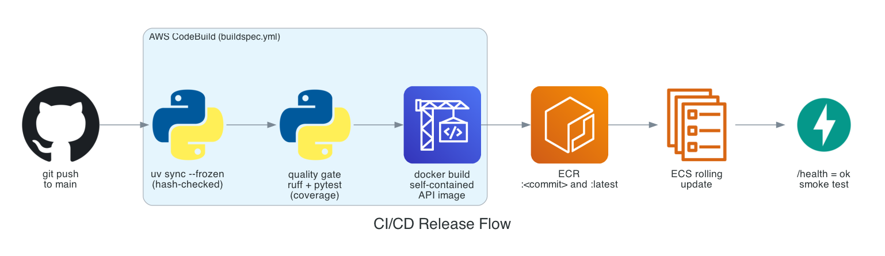

| Terraform file | Resources |
|---|---|
| `main.tf` | ECR repository with a 20-image lifecycle rule, ECS cluster, Fargate task definition and service (1 vCPU, 2 GB), Application Load Balancer, security groups, log group, IAM roles, API key in Parameter Store |
| `cdn.tf` | CloudFront distributions that serve the API and web app over HTTPS; the load balancers accept traffic only from CloudFront |
| `cicd.tf` | CodeBuild project, GitHub credential and webhook, S3 bucket for build inputs, CodeBuild IAM role |
| `monitoring.tf` | Firehose capture stream, S3 monitoring bucket, log subscription filter, SageMaker role, drift and live accuracy schedules, CloudWatch alarms and dashboard, SNS email topic |
| `dashboard.tf` | Dashboard ECR repository, ECS service and load balancer |
| `datalake.tf` | Versioned S3 data lake, Glue catalog database, Athena workgroup |
| `resource_group.tf` | One AWS Resource Group listing every resource in the project |

[buildspec.yml](buildspec.yml) runs in **CodeBuild**. The `install` phase runs `uv sync --frozen`. The `pre_build` phase runs `ruff check .` and `pytest` with coverage, and any failure stops the release. The `build` phase downloads the model artifacts from S3, records build provenance, builds the image, tags it `git-<commit>` and pushes it to **ECR**. The `post_build` phase starts an **ECS** rolling update. Pull requests and other branches run the quality gate and never deploy. A manual build deploys only when started with `DEPLOY_MANUAL=true`.

**Deployment steps.** The first deployment runs in a fixed order, because **ECS** needs an image before it can start and **CodeBuild**, which builds that image, is itself created by **Terraform**. Infrastructure comes up with zero running tasks, the three images are built, and the services then scale to one task each.

<details>
<summary>Full first-time deployment: 8 ordered steps (click here to expand)</summary>

1. **Configure.** Create the git-ignored file `infra/terraform/prod.tfvars`:

   ```hcl
   aws_region        = "us-east-1"
   project_name      = "nyc-taxi"
   environment       = "prod"
   task_cpu          = 1024
   task_memory       = 2048
   enable_cicd       = true
   github_repo_url   = "https://github.com/<you>/nyc-taxi-forecasting.git"
   enable_monitoring = true
   alert_email       = "<you>@example.com"
   enable_datalake   = true
   enable_athena     = true
   enable_dashboard  = true
   ```

2. **Create the infrastructure with zero running tasks.** The **GitHub** token needs the `repo` and `admin:repo_hook` scopes. The token and the API key are read from git-ignored files into `sensitive` variables.

   ```bash
   export AWS_PROFILE=<your-profile>
   export TF_VAR_github_token="$(cat .secrets/github_token)"
   export TF_VAR_api_key="$(cat .secrets/api_key)"
   terraform -chdir=infra/terraform init
   terraform -chdir=infra/terraform apply -var-file=prod.tfvars -var desired_count=0 -var dashboard_desired_count=0
   ```

   HTTPS is on by default (`enable_https = true`): Terraform creates the CloudFront distributions, and the `api_url` and `dashboard_url` outputs are HTTPS addresses.

3. **Upload the model artifacts** that **CodeBuild** bakes into the API image.

   ```bash
   BUCKET=$(terraform -chdir=infra/terraform output -raw cicd_artifacts_bucket)
   aws s3 cp mlflow.db "s3://$BUCKET/mlflow.db"
   aws s3 sync mlruns "s3://$BUCKET/mlruns"
   aws s3 cp data/processed/demand_hourly.parquet "s3://$BUCKET/demand_hourly.parquet"
   ```

4. **Build the API image** in **CodeBuild**.

   ```bash
   PROJECT=$(terraform -chdir=infra/terraform output -raw cicd_project_name)
   aws codebuild start-build --project-name "$PROJECT" \
     --environment-variables-override name=DEPLOY_MANUAL,value=true
   ```

5. **Build the web app image** in **CodeBuild** with its report files.

   ```bash
   aws s3 sync artifacts/responsible "s3://$BUCKET/dashboard/responsible"
   aws s3 sync artifacts/drift "s3://$BUCKET/dashboard/drift"
   aws s3 cp data/raw/taxi_zone_lookup.csv "s3://$BUCKET/dashboard/taxi_zone_lookup.csv"
   aws codebuild start-build --project-name "$PROJECT" --buildspec-override buildspec-dashboard.yml \
     --environment-variables-override \
       name=DASH_ECR_URL,value="$(terraform -chdir=infra/terraform output -raw dashboard_ecr_repository_url)" \
       name=DASH_ECS_SERVICE,value="$(terraform -chdir=infra/terraform output -raw dashboard_service_name)" \
       name=DASH_IMAGE_TAG,value=latest
   ```

6. **Build the monitoring image** for **SageMaker** (x86_64).

   ```bash
   ECR=$(terraform -chdir=infra/terraform output -raw ecr_repository_url)
   aws ecr get-login-password | docker login --username AWS --password-stdin "${ECR%%/*}"
   docker buildx build --platform linux/amd64 -f docker/Dockerfile.monitoring -t "$ECR:monitoring" --push .
   ```

7. **Scale up** to one task per service and switch on the weekly drift and live accuracy schedules.

   ```bash
   terraform -chdir=infra/terraform apply -var-file=prod.tfvars -var monitoring_image_uri="$ECR:monitoring"
   ```

8. **Verify** the live service.

   ```bash
   API_URL=$(terraform -chdir=infra/terraform output -raw api_url)
   DASHBOARD_URL=$(terraform -chdir=infra/terraform output -raw dashboard_url)
   export API_KEY="$(cat .secrets/api_key)"
   .venv/bin/python scripts/aws/verify_staging.py --api-url "$API_URL" --dashboard-url "$DASHBOARD_URL" --timeout 60
   .venv/bin/python scripts/aws/load_test.py --api-url "$API_URL" --dashboard-url "$DASHBOARD_URL" --requests-per-endpoint 100 --concurrency 10
   ```

To test uncommitted changes on AWS, upload a source archive to the build bucket and start the build with `--source-type-override S3`, `--source-location-override "$BUCKET/source/<archive>.zip"` and `SOURCE_LABEL=<name>`; the image is then tagged with that name instead of a commit.

To remove everything:

```bash
terraform -chdir=infra/terraform destroy -var-file=prod.tfvars -var monitoring_image_uri="$ECR:monitoring"
```

</details>

After the first deployment, every push to `main` rebuilds and redeploys the API automatically.

**Results.** The release build passed every phase, both **ECS** services ran 1 of 1 tasks, and the smoke test on AWS passed 10 of 10 checks over HTTPS with the API key.

| Access check on AWS | Result |
|---|---|
| API and web app over HTTPS | 200 |
| API over plain HTTP | 403, refused by CloudFront |
| Web app over plain HTTP | 301, redirected to HTTPS |
| Load balancer reached directly | No connection: it accepts CloudFront only |
| Prediction, `/version` or `/metrics` without the key | 401 |
| Rate limit of 10 per minute, with a new fake `X-Forwarded-For` on every request | 10 accepted, then 429 |

<details>
<summary>CodeBuild release build: all phases succeeded (click here to expand)</summary>

| CodeBuild phase | Status | Seconds |
|---|---|---|
| PROVISIONING | SUCCEEDED | 7 |
| DOWNLOAD_SOURCE | SUCCEEDED | 1 |
| INSTALL: `uv sync --frozen` | SUCCEEDED | 49 |
| PRE_BUILD: Ruff and pytest | SUCCEEDED | 37 |
| BUILD: Docker build and ECR push | SUCCEEDED | 219 |
| POST_BUILD: ECS rolling update | SUCCEEDED | 1 |

Switching the install from pip to uv cut the `INSTALL` phase from 89 to 49 seconds.

</details>

| ECS service | Status | Desired | Running | Pending |
|---|---|---|---|---|
| nyc-taxi-prod-api | ACTIVE | 1 | 1 | 0 |
| nyc-taxi-prod-dashboard | ACTIVE | 1 | 1 | 0 |

<details>
<summary>Smoke test on AWS: 10 of 10 checks passed (click here to expand)</summary>

| Smoke check | Request | HTTP | Passed |
|---|---|---|---|
| health | GET `/health` | 200 | yes |
| fare prediction | POST `/predict/fare` | 200 | yes |
| demand prediction | POST `/predict/demand` | 200 | yes |
| demand forecast | POST `/forecast/demand` | 200 | yes |
| fare explanation | POST `/explain/fare` | 200 | yes |
| demand explanation | POST `/explain/demand` | 200 | yes |
| metrics | GET `/metrics` | 200 | yes |
| invalid fare rejected | POST `/predict/fare` | 422 | yes |
| unknown zone rejected | POST `/predict/demand` | 400 | yes |
| dashboard landing page | GET `/` | 200 | yes |

</details>

**In the AWS console.** Screenshots from the first deployment of this stack. **CodeBuild** records every build with the commit it built, and the webhook starts each one. **ECS** runs both services at 1 of 1 tasks on **Fargate**, and **ECR** holds the encrypted images. Account identifiers are blurred.

| | |
|---|---|
| 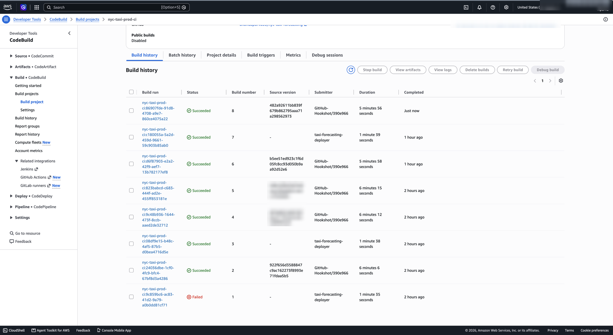 **CodeBuild build history:** webhook builds per commit, all succeeded after the first gate failure | 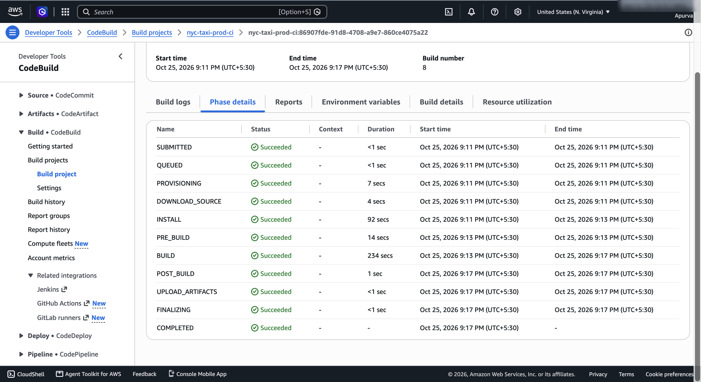 **CodeBuild phases:** install, quality gate, Docker build and ECS update |
| 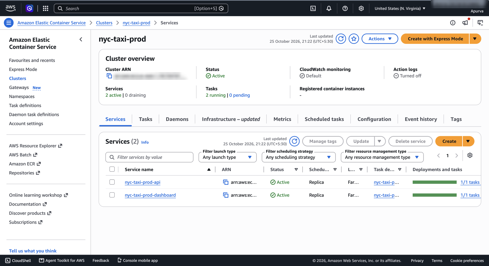 **Amazon ECS:** API and web app services, 1 of 1 tasks each | 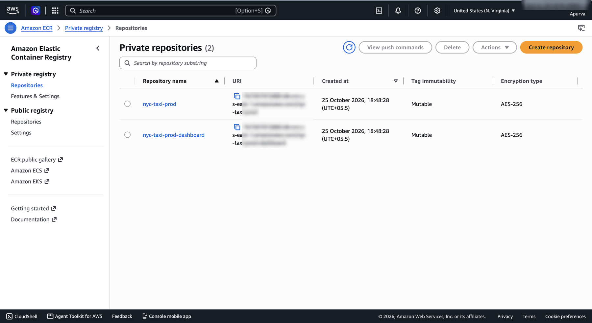 **Amazon ECR:** API and dashboard image repositories, AES-256 encrypted |

---

## Monitoring: drift and live accuracy

Captures every live prediction asynchronously through **CloudWatch Logs**, a subscription filter and **Amazon Data Firehose** into S3. Weekly **Amazon SageMaker Processing** jobs then check the inputs of each model for drift and the demand predictions for accuracy, publish **CloudWatch** metrics and raise alarms through **Amazon SNS**.

1. The API writes one JSON line per prediction to standard output ([src/monitoring/capture.py](src/monitoring/capture.py)), with the exact model version and, for demand, the zone, target hour and serving `method`.
2. **ECS** sends that output to **CloudWatch Logs**. A **subscription filter** forwards prediction events to **Amazon Data Firehose**, which writes them to the **S3 monitoring bucket** under `captured/`.
3. **Drift.** [scripts/monitoring/run_drift_job.py](scripts/monitoring/run_drift_job.py) compares captured inputs with the training data ([src/monitoring/drift.py](src/monitoring/drift.py)):
   - Numeric inputs and predictions: quantile **PSI**, drifting above **0.2**, with the **Kolmogorov-Smirnov** test reported alongside.
   - Zones: category-share **PSI** and a **chi-square** test. They drift only when both agree: PSI above 0.2 and a p-value below 0.05 divided by the number of features tested (Bonferroni), because category PSI alone is inflated by small samples.
   - Hour and day of week: the same category test, against the training hours that fall inside the capture window, with each hour weighted equally. A short window is not drift; traffic piled onto some hours of the window is.

   The job publishes `FeaturesDrifted`, and an alarm on its daily maximum emails the team.
4. **Live accuracy.** [scripts/monitoring/run_performance_job.py](scripts/monitoring/run_performance_job.py) finds the months the captured demand predictions are for, downloads those months' trip files from the TLC, builds hourly counts with the training pipeline's own code, and joins them to the predictions ([src/monitoring/live_performance.py](src/monitoring/live_performance.py)). It computes live RMSE, MAE and WAPE and compares them with the test baseline in [config/performance_baseline.json](config/performance_baseline.json). Hours served by the weekly rule are excluded, so the model is compared like for like. A 20% rise raises `PerformanceDegraded` and its alarm. The TLC publishes each month about two months after it ends, so predictions for later months are reported as `PendingPredictions` and scored on a later run.
5. A third alarm watches API 5xx errors.

**Commands.** [scripts/aws/replay_traffic.py](scripts/aws/replay_traffic.py) sends real held-out February trips and zone-hours through the live API. The `--distance-factor` option multiplies trip distances to simulate a real change in traffic.

```bash
.venv/bin/python -m scripts.aws.replay_traffic --api-url "$API_URL" --rows 1000
.venv/bin/python -m scripts.aws.replay_traffic --api-url "$API_URL" --rows 1000 --distance-factor 3
```

**Firehose** delivers the captured requests within 5 minutes. The jobs then run on their weekly schedules, or on demand from each schedule's own job definition.

**Results: live accuracy.** The job on SageMaker downloaded the February 2024 TLC file itself, built the hourly counts and matched every one of 500 replayed demand predictions:

| Metric | Live | Test baseline | Change | Degraded |
|---|---|---|---|---|
| RMSE | 13.53 | 11.36 | +19.0% | no |
| MAE | 3.75 | 3.49 | +7.6% | no |

`PerformanceDegraded = 0`, `PendingPredictions = 0` and the accuracy alarm stayed **OK**. 500 predictions give a noisy estimate: the test RMSE's own 95% interval is 9.76 to 13.05. An earlier run on 315 different predictions measured 11.60.

**Results: drift.**

| Run | Traffic | Features drifted | Outcome |
|---|---|---|---|
| Real traffic (first deployment) | 1,000 random test-split trips | 0 of 5 fare inputs (largest PSI 0.019) | alarm **OK** |
| Shifted traffic (first deployment) | Same trips, distance x 3 | 1 of 5: `trip_distance`, PSI **1.90** | alarm **ALARM**, email delivered |
| Verification traffic, before the fixes | Test-split trips and zone-hours from 27 to 29 February, plus 100 repeated load-test requests | Demand: `day_of_week` (PSI **8.17**) and `hour` (PSI 0.49); fare: `PULocationID` (PSI 0.20) | alarm **ALARM** |
| Verification traffic, after the fixes | 500 test-split trips and 500 zone-hours from the same window | 0 of 2 demand and 0 of 5 fare features: `day_of_week` PSI 0.005; `DOLocationID` PSI 0.21 but p = 0.04, not significant across 5 tests | no drift reported |

The first verification run exposed two false alarms rather than real drift. The replayed traffic covered only Tuesday to Thursday, while training covered every day of the week, and 500 trips spread over about 100 zones push category PSI up by chance. The fixes are described in [Engineering decisions](#engineering-decisions). The CloudWatch alarm takes the day's maximum, so it returns to OK once a day passes without drift.

An offline drift drill, [scripts/monitoring/demo_drift_report.py](scripts/monitoring/demo_drift_report.py), checks every model feature without AWS. It flagged `lag_1` and `lag_24` (**PSI** 13.45 and 13.61) out of 20 demand features and `PULocationID` and `DOLocationID` (PSI 12.38 and 10.69) out of 16 fare features, exactly the features it shifted.

**In the AWS console.** Screenshots from the first deployment: **SageMaker** lists every drift run, **CloudWatch** shows the drift alarm firing beside the healthy API error alarm, and **SNS** delivered the alert email. The two failed SageMaker runs are the region and exit-code issues described in [Issues found and fixed](#issues-found-and-fixed); the reruns after each fix completed. Account identifiers are blurred.

| | |
|---|---|
| 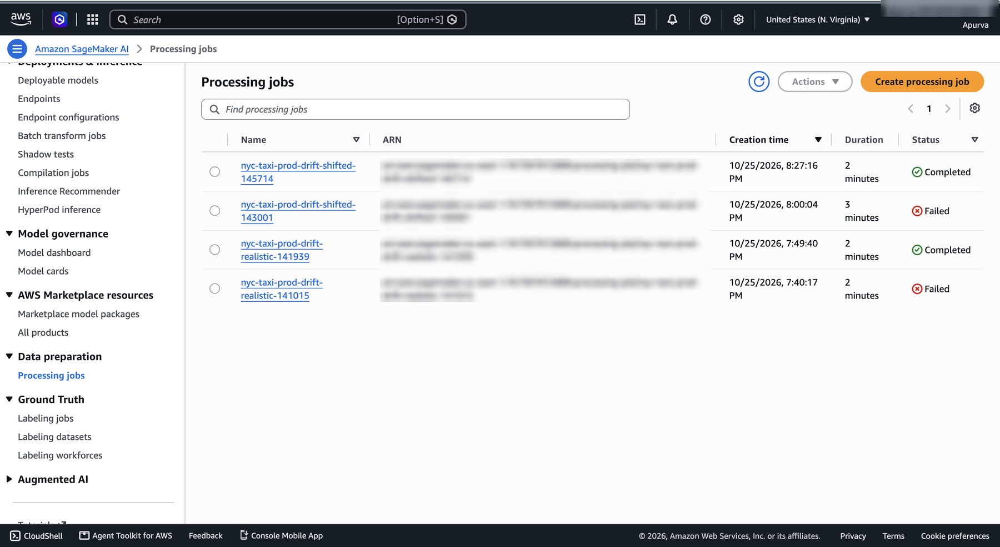 **SageMaker Processing:** drift runs on real and shifted traffic | 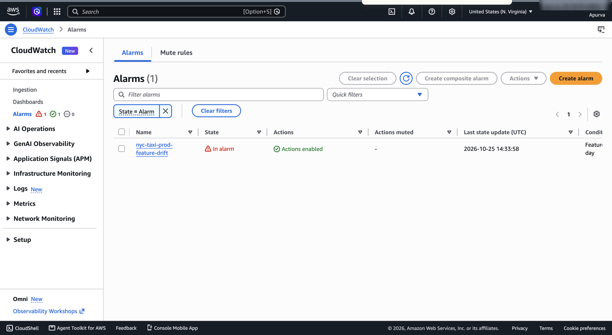 **CloudWatch alarm:** `nyc-taxi-prod-feature-drift` in alarm |
| 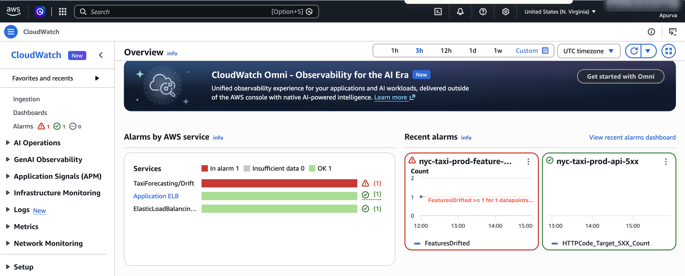 **CloudWatch overview:** drift metric crossing its threshold, API 5xx alarm OK | 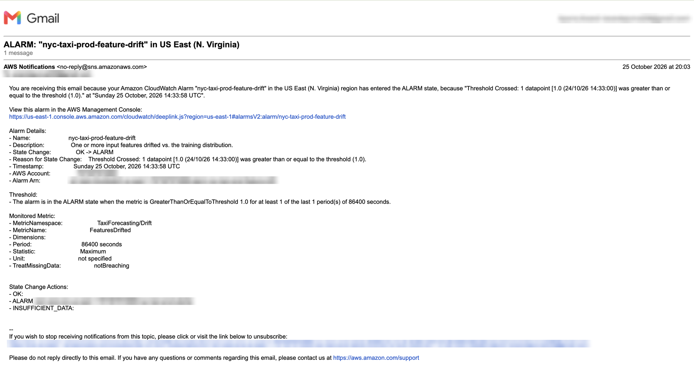 **SNS alert email:** state change OK to ALARM |

---

## Responsible AI

Explains individual predictions with **SHAP** **TreeExplainer**, audits test-set error across borough, time of day, day type, holiday and airport subgroups for all three models, flags low-confidence requests in the API, and publishes the reports to a versioned S3 data lake with object metadata that links each file to its Git commit.

**SHAP** assigns each feature a signed contribution to a prediction. The API explains single predictions at `/explain/fare` and `/explain/demand`. The subgroup analysis ([src/responsible/fairness.py](src/responsible/fairness.py)) compares groups on **WAPE**, total absolute error over total actual, because raw RMSE grows with volume. A dimension is flagged when the worst group's WAPE is more than **1.5 times** the best group's. Groups averaging less than one unit per row are listed but left out of the ratio, because WAPE is unstable near zero. SHAP shows how the model uses its inputs. It does not prove cause and effect.

**Commands**

```bash
.venv/bin/python -m scripts.responsible.run_analysis
bash scripts/aws/publish_fairness_evidence.sh
```

**Results: what drives the models.** Global **SHAP** summaries from the registered models. Each dot is one prediction: its position shows how much a feature pushed that prediction up or down, and its colour shows whether the feature value was high (red) or low (blue).

| Fare model (LightGBM) | Demand model (XGBoost) | Booking-time fare model (LightGBM) |
|---|---|---|
| 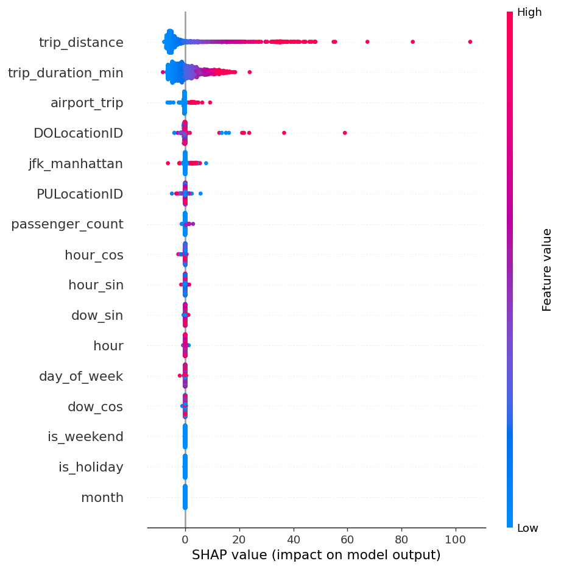 | 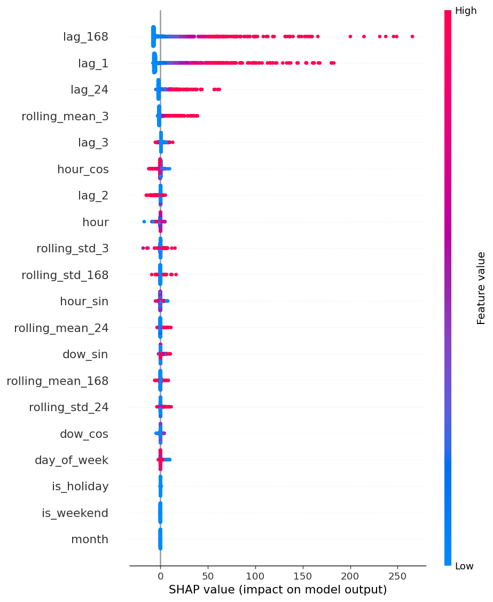 | 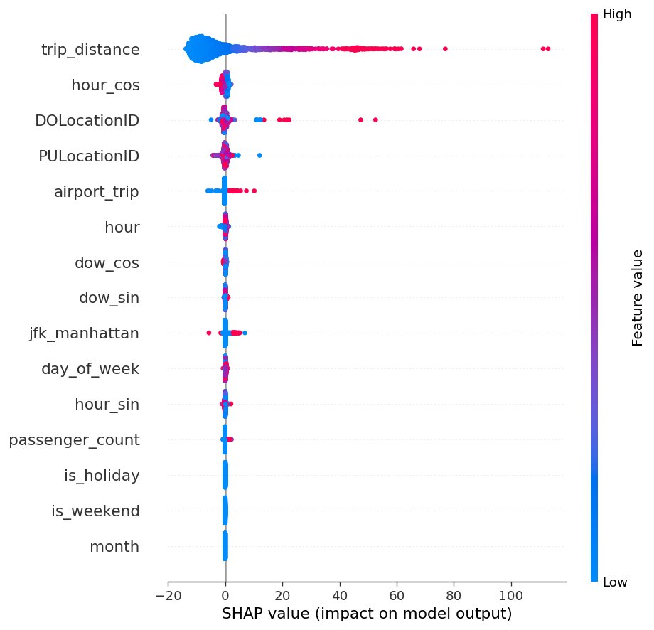 |
| `trip_distance` dominates and long trips add up to about $100. `trip_duration_min` comes second, followed by the airport flag and some drop-off zones that add $20 to $60. | `lag_168`, the same hour one week earlier, is the strongest feature, ahead of the previous hour (`lag_1`) and the same hour yesterday (`lag_24`). The model has learned the weekly rhythm of the city. | Without the duration, `trip_distance` carries even more weight, followed by time of day, the drop-off and pickup zones and the airport flags. |

`month` has no effect in any model because the training data covers a single month.

**A single prediction explained.** The deployed API explained a 17-mile trip from JFK Airport (zone 132) to Times Square (zone 230) at 18:30 on 27 February 2024, quoted without a duration. The booking-time model's base value of **$18.33** plus the contributions of every feature adds up to the predicted fare of **$69.94**: distance adds $44.60, the JFK-to-Manhattan flag $3.79 and the airport flag $3.10.

<details>
<summary><code>POST /explain/fare</code> response recorded on AWS, values rounded to cents (click here to expand)</summary>

```json
{
  "problem": "fare",
  "prediction": 69.94,
  "base_value": 18.33,
  "contributions": [
    {"feature": "trip_distance", "value": 44.60},
    {"feature": "jfk_manhattan", "value": 3.79},
    {"feature": "airport_trip", "value": 3.10},
    {"feature": "DOLocationID", "value": 0.32},
    {"feature": "dow_cos", "value": -0.23},
    {"feature": "hour", "value": 0.16},
    {"feature": "passenger_count", "value": -0.10},
    {"feature": "hour_sin", "value": 0.08},
    {"feature": "dow_sin", "value": -0.08},
    {"feature": "PULocationID", "value": -0.05},
    {"feature": "is_holiday", "value": 0.03},
    {"feature": "day_of_week", "value": -0.01},
    {"feature": "hour_cos", "value": 0.01},
    {"feature": "is_weekend", "value": 0.00},
    {"feature": "month", "value": 0.00}
  ]
}
```

</details>

**Results: subgroup audit** (test split, WAPE):

| Model | Dimension | Ratio | Worst group | Best group | Finding |
|---|---|---|---|---|---|
| Demand | Time of day | **3.05**, flagged | Overnight (0.391) | Afternoon (0.128) | Overnight counts are small and irregular, so relative errors are largest |
| Demand | Borough | **1.80**, flagged | Unknown zone (0.273) | Manhattan (0.151) | Staten Island, the Bronx, Newark Airport and Brooklyn average under one pickup per zone-hour and are not compared |
| Demand | Airport | 1.17 | Other zones (0.169) | Airport zones (0.145) | Airport zones have the largest absolute errors (RMSE 37.45) but similar relative error |
| Fare | Borough | **4.29**, flagged | Brooklyn (0.164) | Manhattan (0.038) | Outer-borough trips are rarer, longer and less regular |
| Fare | Airport | 1.21 | Other trips (0.043) | Airport trips (0.036) | Airport trips: RMSE $7.22 |
| Booking-time fare | Borough | **2.98**, flagged | Bronx (0.182) | Queens (0.061) | Without the duration, outer-borough fares are harder to quote |
| Booking-time fare | Airport | **2.15**, flagged | Other trips (0.111) | Airport trips (0.052) | Airport fares are close to flat, so they are easier to quote than street trips |

The test window covers only weekdays and no holiday, so day type and holiday are reported as coverage gaps, not as parity.

| Gap | Action | Status |
|---|---|---|
| Unknown zones | Mark predictions for zones 264 and 265 as `low_confidence`, with a reason, in the API response | Done |
| Airport fares | Add airport and JFK-to-Manhattan flat-fare features | Done: airport fare RMSE is $7.22 (it was $7.50 before), still above the $5.00 goal |
| Outer-borough fares | Add tolls and route features | Open |
| Airport demand | Add flight arrival counts as a feature | Open |

The evidence script publishes the subgroup reports, **SHAP** summaries and model cards to the versioned S3 data lake under a stable `latest/` key and an immutable timestamped key. Every object carries metadata with the problem, evidence type and Git commit, and receives an S3 version ID. Model cards are in [docs/model_cards/](docs/model_cards/).

**In the AWS console.** Each evidence file sits under a timestamped key in the versioned data lake and carries its own S3 version ID. Screenshot from the first deployment; account identifiers are blurred.

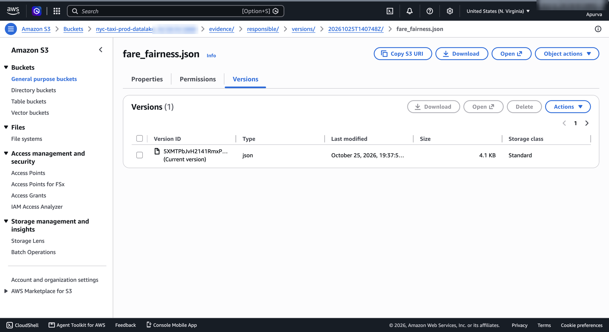

---

## Streamlit web app

A **Streamlit** application running as its own **ECS** **Fargate** service behind its own load balancer and CloudFront distribution, served over HTTPS. It calls the live API with the API key for predictions, forecasts and **SHAP** explanations, and renders the model cards, subgroup reports and drift reports with **Plotly**.

| Page | Shows |
|---|---|
| Overview | Live API health and headline model quality |
| Demand forecast | Multi-hour forecast for selected zones, charted by hour and totalled by zone |
| Fare prediction | Live fare quote with the model that answered and its SHAP breakdown |
| Explainability | SHAP contributions for a single demand prediction |
| Responsible AI | Subgroup error tables and global SHAP plots for each of the three models |
| Monitoring and KPIs | Next-hour demand by borough, top zones and the offline drift drill with PSI, KS and flags |

**Commands**

```bash
uv sync --frozen --group dashboard
API_BASE_URL=http://127.0.0.1:8000 .venv/bin/python -m streamlit run dashboard/app.py --server.port 8501
```

On AWS the web app runs as its own **ECS** service behind its own load balancer and CloudFront, reads the API key from Parameter Store and calls the API over HTTPS.

**Results.** Screenshots taken from the AWS deployment.

| | |
|---|---|
| 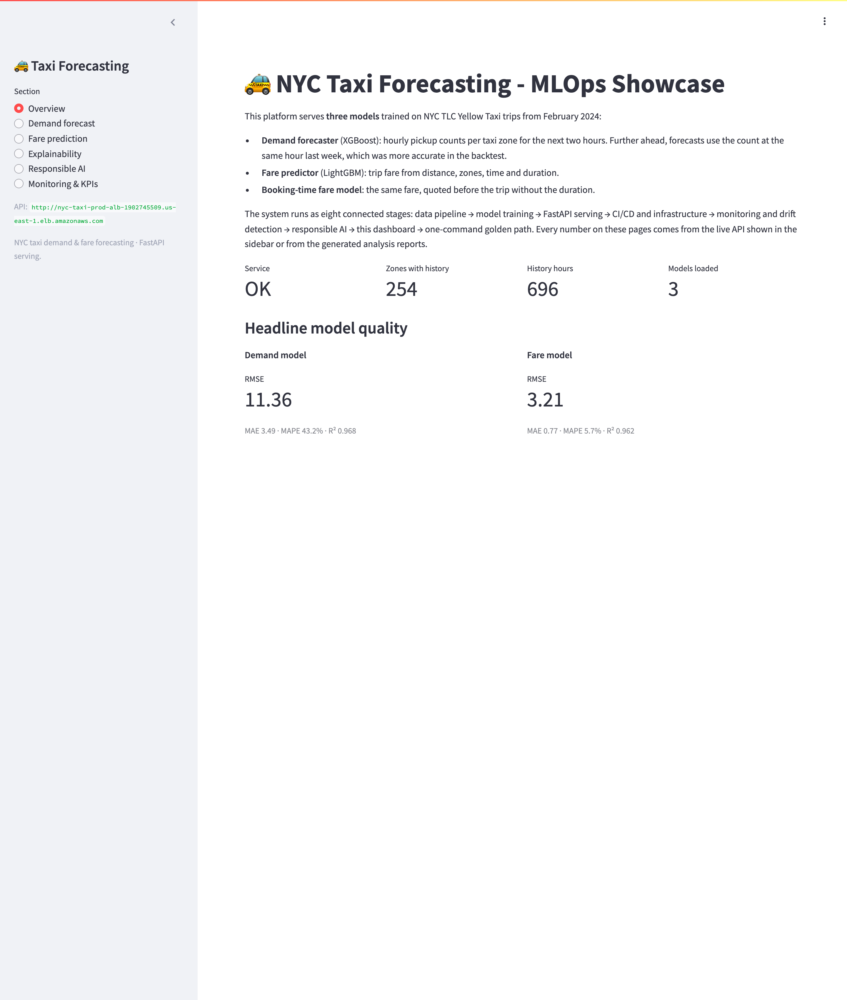 **Overview** | 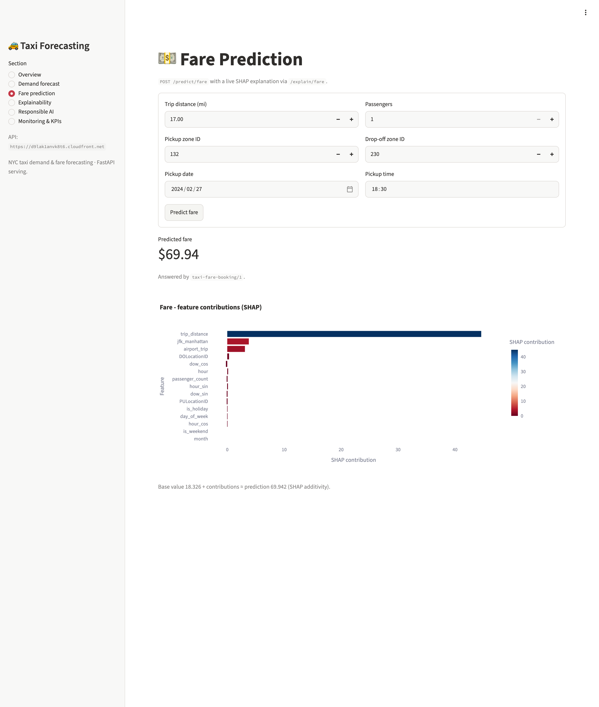 **Fare prediction** |
| 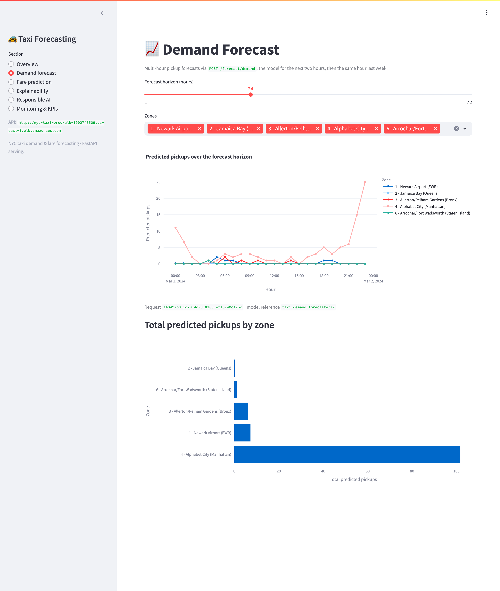 **Demand forecast** | 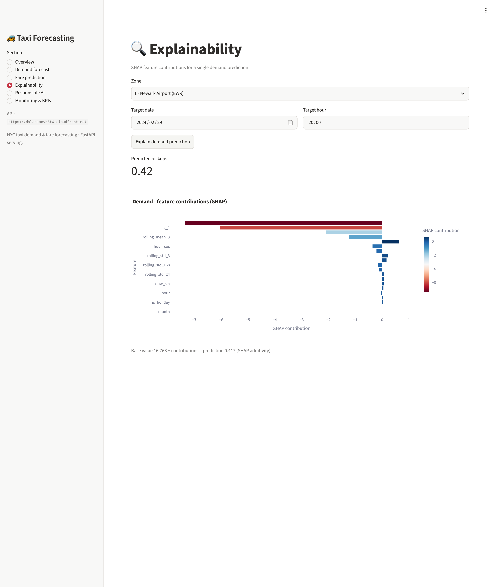 **Explainability** |
| 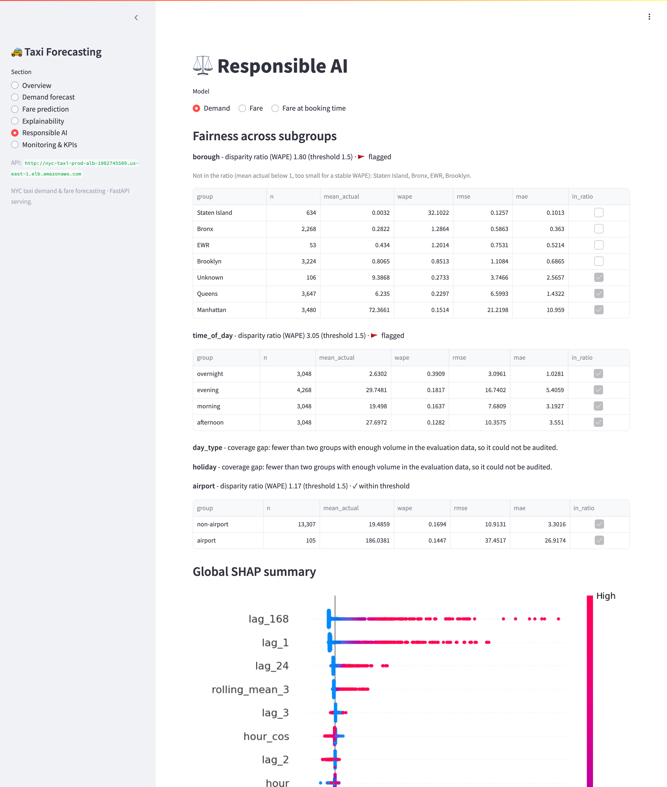 **Responsible AI** | 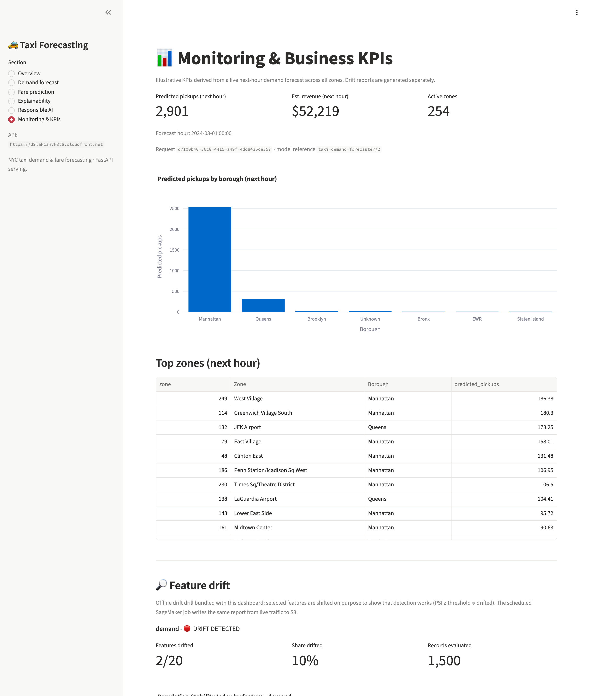 **Monitoring and KPIs** |

---

## Reproducible golden path

A single Bash entry point rebuilds the whole project from a new, empty copy of the repository and verifies every stage, from environment setup to drift detection.

[scripts/golden_path.sh](scripts/golden_path.sh) runs 13 stages in order, writes one log per stage to `logs/golden_path/`, stops at the first failure and records the commit, timings and status of every stage in `logs/golden_path/summary.json`. It uses 5 tuning trials per candidate to keep the run short.

**Commands**

```bash
bash scripts/golden_path.sh
```

**Results.** Run on a new, empty copy of the repository, with no data, models or environment carried over: **13 of 13 stages passed in 15 minutes 2 seconds**, starting from an empty uv cache.

<details>
<summary>Stage-by-stage result (click here to expand)</summary>

| Stage | What it proves | Status | Seconds |
|---|---|---|---|
| 01 environment | `uv sync --frozen` builds the Python 3.11 environment from `uv.lock` | ok | 30 |
| 02 lint | Ruff passes | ok | 1 |
| 03 tests | All unit and integration tests pass | ok | 54 |
| 04 data pipeline | February 2024 data downloads, cleans and splits | ok | 10 |
| 05 pipeline outputs | Summary, demand history and all six split files exist | ok | 0 |
| 06 real data checks | On the real data: raw schema, chronological splits, lags that use only past hours, and pickup counts that keep trips the fare rules drop | ok | 1 |
| 07 train and register | All three problems tune, train and register a champion | ok | 370 |
| 08 evaluation | Baselines, multi-hour accuracy and booking-time fares are scored | ok | 375 |
| 09 batch inference | Routed forecasts are written to `predictions.db` | ok | 9 |
| 10 API smoke test | API starts, `/health` is ok, every endpoint passes, invalid input is rejected | ok | 6 |
| 11 responsible AI | SHAP and subgroup reports and model cards are written | ok | 30 |
| 12 drift report | Drift detection flags the shifted features | ok | 16 |
| 13 final outputs | Every expected artifact exists | ok | 0 |
| **Total** | | **13 of 13** | **902 (15 min 2 s)** |

</details>

---

## Issues found and fixed

Real problems found while building, evaluating and deploying this system, and how each was resolved.

| # | Symptom | Cause | Fix | Proof |
|---|---|---|---|---|
| 1 | `pip install` failed building LightGBM on macOS | The OpenMP runtime `libomp` was missing, so LightGBM compiled from source and failed to link | Installed `libomp` with Homebrew | LightGBM and XGBoost import and train |
| 2 | An MLflow test failed with `ImportError: FallbackAsyncAdaptedQueuePool` | SQLAlchemy 2.1 removed a class MLflow imports, and SQLAlchemy was not pinned | Pinned `sqlalchemy<2.1`; every dependency is now locked in `uv.lock` | All tests pass locally, in GitHub Actions and in CodeBuild |
| 3 | The first CodeBuild release stopped at `PRE_BUILD` | Ruff rule `I001`: unsorted imports | Sorted the imports and pushed; the webhook started a new build | The gate blocked the commit before any image was built |
| 4 | Load-test p95 was 726 ms against a 500 ms target | Every request opened a new TCP connection, paying an extra network round trip | Reused HTTP connections in the load test and the web app client | p95 dropped to 331 ms (fare) and 298 ms (demand); 373 and 349 ms after adding HTTPS |
| 5 | The AWS drift job silently skipped pickup and drop-off zones | Captured requests use API names (`pu_location_id`), the reference uses training names (`PULocationID`) | Mapped captured names to feature names, with a unit test | Zone features appear in every fare drift report |
| 6 | The drift job failed with `NoRegionError`, so the drift alarm could never fire | SageMaker Processing containers start without an AWS region, which CloudWatch needs | Set `AWS_DEFAULT_REGION` in the Terraform job definition | Metrics published and the alarm fired on shifted traffic |
| 7 | The `--fail-on-drift` flag could never be turned off | The flag used `store_true` with a default of `True` | Switched to an on and off flag pair and pass `--no-fail-on-drift` on schedule | Drift runs complete and report drift through the alarm |
| 8 | Demand undercounted pickups by 9.5% | Demand was built from trips cleaned for the fare model, so trips with an implausible fare or passenger count vanished from the pickup counts | Count every trip with a valid pickup time and zone | 3,007,511 pickups instead of 2,722,931 |
| 9 | The 24-hour forecast had never been checked beyond one hour ahead | Evaluation scored one step ahead with true lags, but the API feeds its own predictions back in | Scored the real recursive forecaster at 57 origins against naive rules, then routed by horizon | Served forecast 13.81 against 14.77 for the model alone |
| 10 | Fares without a trip duration were off by $6.14 RMSE | The API guessed the duration at 3 minutes per mile for a model trained on real durations | Trained a booking-time model without the duration | $3.98 RMSE |
| 11 | `/predict/demand` for a future hour treated every unknown recent hour as zero pickups | Lag features were filled with zeros past the end of the history | Single predictions follow the same horizon routing as forecasts | Unit tests compare single predictions with the forecast |
| 12 | The fairness audit always flagged Manhattan, with a ratio of 352 | RMSE grows with volume, so the busiest borough always looked worst | Compare groups on WAPE and leave out groups with almost no volume | Demand borough ratio 1.80, with the worst group now the unknown zone |
| 13 | Optuna tuned and selected on the same validation data | Selection was made on scores the tuning had already optimised | Tune on a holdout from the end of the training period and record a bootstrap interval on the validation margin | The demand tie is recorded instead of hidden |
| 14 | A dependency scan found 191 known vulnerabilities in 10 packages, 81 of them in MLflow | Versions were pinned once and never audited | Moved to a **uv** lockfile, upgraded to patched releases including MLflow 3, and made **pip-audit** a blocking CI step | 0 known vulnerabilities in 257 locked packages; all three models give identical predictions after the upgrade |
| 15 | Any caller could reset their rate limit by sending a new `X-Forwarded-For` header | The limiter read the first address in the header, which the client controls, and never forgot old clients | Read the address the outermost trusted proxy recorded and drop idle clients each minute | On AWS, a new fake header on every request was still cut off at the limit |
| 16 | The registry baked into the image still pointed at paths on the training machine | The path-rewriting script only matched Windows `file://` URIs, not macOS and Linux paths, so it changed 0 paths; serving worked only through a fallback | Match both forms, including MLflow 3's logged-model table, with a regression test | 26 paths rewritten; the container loads every model directly |
| 17 | Training new models failed after the MLflow 3 upgrade | MLflow 3 saves models with skops, which refuses types it was not told to trust | Trust only types from XGBoost, LightGBM, scikit-learn and NumPy, and refuse anything else | The golden path trains and registers all three models; a container built from them serves correctly |
| 18 | One test wrote a model into the project's real MLflow registry | MLflow 3 defaults to `sqlite:///mlflow.db` in the working directory | The test session now points MLflow at a temporary store | The registry file is byte-identical before and after the full test run |
| 19 | Real traffic from a three-day window raised the drift alarm | Hour and day of week were compared as numbers against all of training | Compare them by category against the hours inside the capture window | `day_of_week` PSI fell from 8.17 to 0.005 on the same kind of traffic |
| 20 | 500 random trips with no drift crossed the zone PSI threshold 6 times in 20 | Category PSI is inflated by small samples | Require a significant chi-square test as well, Bonferroni-corrected | 0 false alarms in 40 trials; a 10% shift is still caught |

---

## Security

- **HTTPS only.** **CloudFront** serves the API and web app over TLS with its default certificate. Plain HTTP to the API is refused, the web app redirects to HTTPS, and the load balancers accept traffic only from CloudFront's origin-facing addresses, so the API key never crosses the internet unencrypted.
- **API key.** Every endpoint except `/health` and `/docs` requires an `X-API-Key` header, checked in constant time. On AWS the key is a `SecureString` in **Systems Manager Parameter Store**, injected into the API and dashboard tasks by **ECS**, and never stored in the image or in Git.
- **Rate limiting.** Each client is limited to a configured number of requests per minute, returning HTTP 429 with `Retry-After`. The client is identified by the address the trusted proxies recorded, so a forged `X-Forwarded-For` header does not help. Cross-origin requests are refused unless origins are listed explicitly.
- **Supply chain.** Every dependency is locked with hashes in `uv.lock`, every locked package is scanned with **pip-audit** on each build, and **Dependabot** proposes updates weekly. Saved models load only explicitly trusted types.
- **One IAM role per service.** The **ECS** task, **CodeBuild**, **Firehose**, the CloudWatch-to-Firehose subscription, **SageMaker** and **EventBridge Scheduler** each run under their own role. Only the ECS execution role can read the API key.
- **Least-privilege containers.** The API image runs as a non-root user and installs only the runtime dependency group.
- **Private by default.** Every S3 bucket blocks public access, and each container accepts traffic only from its own load balancer's security group.
- **Image scanning.** Both **ECR** repositories scan every image for known vulnerabilities on push.
- **No secrets in Git.** AWS access uses a dedicated **IAM** user through a local CLI profile. The **GitHub** token and the API key are read from git-ignored files into `sensitive` **Terraform** variables. Terraform state, variable files and plan files are git-ignored.

---

## Cost

While running, the stack costs about **$4.50 per day**: two load balancers, the API task (1 vCPU, 2 GB), the web app task (0.5 vCPU, 1 GB) and their public IP addresses. **SageMaker** is billed only for the minutes each monitoring job runs, and logs, S3, **Firehose**, **CloudFront**, Parameter Store and alarms cost a few cents. The whole stack is created and removed with **Terraform**, so `terraform destroy` stops all charges. That is how this deployment was shut down after verification.

---

## What I would build next

1. **Training on several months**, so the demand model sees enough weeks to beat the weekly pattern further ahead, and a direct multi-hour model trained on that history.
2. **A custom domain** with an AWS Certificate Manager certificate on CloudFront, and **AWS WAF** rate rules at the edge, so the limit holds across several API tasks.
3. **Blue-green deployments** through CodeDeploy, with automatic rollback to the previous commit-tagged image.
4. **Gated automatic retraining** on each new month of data: retrain, compare against the live model on the same evaluation, and promote only if it wins.
5. **Rotating API keys** per client, with usage tracked per key.

---

## Limitations

1. The models are trained on one month of Yellow Taxi data (February 2024). Seasonal effects, holidays outside that month and other taxi types are not covered.
2. The test window is the final days of February 2024, which are all weekdays, so weekend and holiday accuracy is not measured on test.
3. The 2-hour cut-over between the demand model and the weekly rule was chosen from the same backtest week that reports it, and the model's lead 2 hours ahead is not statistically clear.
4. The fare models predict `fare_amount` only. Tips, tolls, surcharges and the total bill are not predicted.
5. Forecasts start after the last stored hour of history, not from the current clock time.
6. The AWS drift job checks the fields a client sends: 5 fare inputs, and the hour and day of week for demand. The demand training table holds every zone in every hour, so zone drift is checked for fares only. Derived features such as lags are checked by the offline drift drill. Below about 300 requests per window, the zone check can still raise an occasional false alarm (3 in 40 trials).
7. Live accuracy depends on the TLC's monthly files, which arrive about two months after each month ends, so the accuracy alarm reacts weeks after a problem starts.
8. The rate limit is kept in memory per API task, so with several tasks each one enforces it separately.
9. The API key is a single shared key without rotation.

---

## Repository layout

| Path | Contents |
|---|---|
| `src/data/`, `src/features/` | Ingestion, validation, aggregation, feature engineering, time splits |
| `src/models/` | Tuning, training, bootstrap intervals, evaluation against baselines, registry |
| `src/serving/` | FastAPI app, schemas, security, inference service, batch forecasting |
| `src/monitoring/` | Prediction capture, drift detection, live accuracy |
| `src/responsible/` | Subgroup error analysis, explainability, model cards |
| `scripts/` | Command entry points, including `golden_path.sh`, the evaluation and the AWS scripts |
| `dashboard/` | Streamlit web app |
| `docker/` | API, web app and monitoring Dockerfiles, Compose file |
| `infra/terraform/` | All AWS infrastructure |
| `pyproject.toml`, `uv.lock` | Dependency groups (runtime, dev, dashboard, monitoring, aws) and the hash-checked lockfile |
| `.github/` | GitHub Actions quality gate and weekly real-data check, Dependabot configuration |
| `retraining/` | SageMaker pipeline definition for gated retraining |
| `tests/` | 176 unit and integration tests on synthetic data and 5 checks on the real data |
| `notebooks/` | Data exploration notebook |
| `docs/` | Diagrams, API examples, data statement, model cards |
