# NYC Taxi Demand and Fare Forecasting: End-to-End MLOps on AWS


An end-to-end **MLOps** platform on AWS that forecasts hourly pickup demand across 252 New York City taxi zones and predicts individual trip fares, built from 3 million NYC TLC trip records.

**XGBoost** and **LightGBM** regressors are tuned with **Optuna**, tracked and versioned in the **MLflow Model Registry**, and served by a **FastAPI** inference service on **Amazon ECS Fargate** behind an **Application Load Balancer**. All 59 cloud resources are defined in **Terraform**. A **GitHub** webhook triggers **AWS CodeBuild**, which runs **Ruff** and **pytest** quality gates, builds a self-contained **Docker** image, pushes it to **Amazon ECR** and rolls out the ECS service. Every prediction streams through **CloudWatch Logs** and **Amazon Data Firehose** into **Amazon S3**, where a scheduled **Amazon SageMaker Processing** job, triggered by **EventBridge Scheduler**, measures feature drift with the **Population Stability Index** and **Kolmogorov-Smirnov** tests and raises **CloudWatch alarms** through **Amazon SNS**. **SHAP** explainability, subgroup error audits published to a versioned S3 data lake with **AWS Glue** and **Amazon Athena**, a **Streamlit** dashboard on its own ECS service, and a one-command reproducible build complete the system.

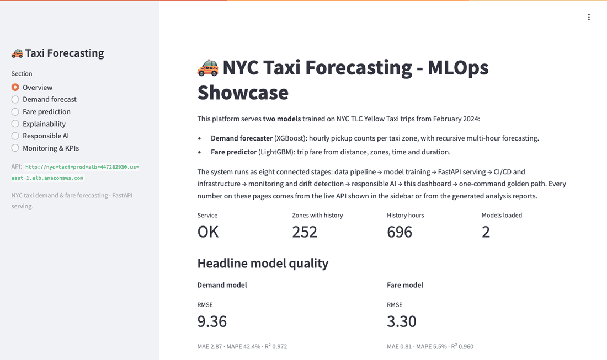

| **0.960** | **0.972** | **5.8 ms** | **402 ms** | **59** | **122** |
|:---:|:---:|:---:|:---:|:---:|:---:|
| Fare model R² | Demand model R² | Median server latency | p95 end-to-end latency | AWS resources in Terraform | Automated tests |

---

## Contents

1. [Results at a glance](#results-at-a-glance)
2. [Tech stack](#tech-stack)
3. [Architecture](#architecture)
4. [Engineering decisions](#engineering-decisions)
5. [Dataset](#dataset)
6. [Quick start](#quick-start)
7. [Data pipeline](#data-pipeline)
8. [Model training and registry](#model-training-and-registry)
9. [Real-time API and batch inference](#real-time-api-and-batch-inference)
10. [CI/CD and infrastructure on AWS](#cicd-and-infrastructure-on-aws)
11. [Monitoring and drift detection](#monitoring-and-drift-detection)
12. [Responsible AI](#responsible-ai)
13. [Dashboard](#dashboard)
14. [Reproducible golden path](#reproducible-golden-path)
15. [Issues found and fixed](#issues-found-and-fixed)
16. [Security](#security)
17. [Cost](#cost)
18. [What I would build next](#what-i-would-build-next)
19. [Limitations](#limitations)
20. [Repository layout](#repository-layout)

---

## Results at a glance

Models are selected on the **validation** set and reported on the **test** set, which the selection step never sees. Data: NYC Yellow Taxi, February 2024.

| Problem | Model | Test RMSE | Test MAE | Test R² |
|---|---|---|---|---|
| Demand: pickups per zone per hour | XGBoost | 9.36 pickups | 2.87 pickups | 0.972 |
| Fare: `fare_amount` per trip | LightGBM | $3.30 | $0.81 | 0.960 |

| Area | Outcome |
|---|---|
| Data | 3,007,526 raw trips cleaned to 2,722,931 (90.5% kept) |
| Quality gate | Ruff clean, 122 unit and integration tests passing |
| Infrastructure | 59 AWS resources from Terraform; API and dashboard ran 1 of 1 tasks |
| Release | GitHub push triggers CodeBuild: lint, tests, Docker build, ECR push, ECS rollout |
| Checks on AWS | 10 of 10 smoke checks and 400 of 400 load-test requests passed |
| Latency | 5.8 ms median server time; p95 402 ms (fare) and 291 ms (demand) end to end |
| Drift | Real traffic: no drift. Shifted traffic: `trip_distance` flagged (PSI 1.90), alarm fired, email received |
| Responsible AI | Subgroup audit found the largest gaps for airport trips and busy Manhattan zones, with a mitigation plan |
| Reproducibility | One command takes a new, empty copy of the repository to trained, served and audited models: 11 of 11 stages in 5 min 26 s |

---

## Tech stack

| Area | Tools |
|---|---|
| Language | Python 3.11 |
| Data processing | pandas, Parquet (PyArrow) |
| Modelling | XGBoost, LightGBM, scikit-learn |
| Hyperparameter tuning | Optuna |
| Experiment tracking and model registry | MLflow |
| Explainability and drift | SHAP, Population Stability Index, Kolmogorov-Smirnov test (SciPy) |
| Serving | FastAPI, Pydantic, Uvicorn, Prometheus instrumentation |
| Dashboard | Streamlit, Plotly |
| Packaging | Docker (multi-stage builds), Docker Compose |
| Infrastructure as code | Terraform |
| Compute and networking | Amazon ECS on Fargate, Application Load Balancer, Amazon VPC |
| Delivery | GitHub webhooks, AWS CodeBuild, Amazon ECR |
| Monitoring | Amazon CloudWatch Logs, metrics and alarms, Amazon Data Firehose, Amazon SNS |
| ML operations | Amazon SageMaker Processing, Amazon EventBridge Scheduler |
| Storage and analytics | Amazon S3 with versioning, AWS Glue Data Catalog, Amazon Athena |
| Security | AWS IAM (one role per service), VPC security groups, Amazon ECR image scanning |
| Quality | pytest with coverage, Ruff |

---

## Architecture


The system is split into three paths, each with one job:

| Path | Question it answers | Services |
|---|---|---|
| **Serving** | Who answers the customer? | Application Load Balancer → ECS service → Fargate task running FastAPI with both models in memory |
| **Release** | Who ships a change? | GitHub webhook → CodeBuild (lint, tests, Docker build) → ECR → ECS rolling update |
| **Evidence** | Who records what happened? | CloudWatch Logs → Data Firehose → S3 → SageMaker Processing → CloudWatch metrics and alarms → SNS email |


All diagrams are generated from code in [docs/diagrams/generate.py](docs/diagrams/generate.py) with the [`diagrams`](https://diagrams.mingrammer.com) library and the official AWS icon set.

---

## Engineering decisions

**Serve on ECS Fargate, not a SageMaker endpoint.** The API does more than return a prediction. It validates input, runs recursive multi-hour forecasts against an in-memory demand history and returns **SHAP** explanations. A custom **FastAPI** container handles all of that, and the same image runs locally with **Docker Compose** and on AWS. SageMaker is used where its pay-per-run model fits best: the scheduled drift job.

**Choose the model on validation data, never on test data.** For demand, **LightGBM** scored slightly better on the test set (9.21 against 9.36 RMSE), but **XGBoost** won on validation (10.387 against 10.400), so XGBoost was registered. Switching after seeing test results would turn the test set into a second validation set and remove the only unbiased estimate of real-world error.

**Split by time, not at random.** Demand features include lags of 1 hour to 1 week. A random split would let the model learn from hours that come after the ones it is tested on. Training uses the first 80% of February, validation the next 10% and test the final 10%.

**Bake the models into the image.** Each API image contains the code, the registered models, a portable copy of the **MLflow** registry and the demand history. A release is a single immutable artifact, and the running service depends on no external model server. A new model therefore needs a new image, and **CodeBuild** automates that rebuild.

**Capture predictions through logs, not in the request path.** The API writes one JSON line per prediction to standard output. **CloudWatch Logs**, a subscription filter and **Firehose** deliver those lines to S3. This adds no latency to requests and no extra dependency to the API, and predictions keep flowing even if the monitoring pipeline is down.

**Let PSI raise the flag and KS support it.** With about 1,000 captured requests, the **Kolmogorov-Smirnov** test marks very small differences as significant. In the real-traffic run, `trip_duration_min` had a KS p-value of 0.013 while its PSI was only 0.014. Flagging on PSI above 0.2 keeps the alarm for changes large enough to matter.

**Treat a drift alarm as the start of an investigation.** The alarm emails a person. Nothing retrains or redeploys automatically, because a new model must pass the same validation and quality gate as the current one before it ships.

---

## Dataset

| Item | Detail |
|---|---|
| Source | [NYC Taxi and Limousine Commission trip records](https://www.nyc.gov/site/tlc/about/tlc-trip-record-data.page) |
| File | `yellow_tripdata_2024-02.parquet`: 3,007,526 trips, 19 columns |
| Zone lookup | `taxi_zone_lookup.csv`: 265 zones with borough and service zone |
| Key columns | pickup and drop-off timestamps, pickup and drop-off zone IDs, trip distance, passenger count, fare amount |
| Configuration | `tlc_year: 2024`, `tlc_month: 2` in [config/config.yaml](config/config.yaml) |

| Stage | One row is |
|---|---|
| Raw and clean trips | one taxi trip |
| Demand table | one pickup zone in one hour, including hours with zero pickups |
| Fare table | one clean trip with its engineered features |

The data has no rider names or demographic fields. Zones and boroughs are geographic groups, not personal attributes. Full scope and limits are in [docs/DATA_STATEMENT.md](docs/DATA_STATEMENT.md).

---

## Quick start

Requirements: **Python** 3.11, Git and, on macOS, `brew install libomp` for **XGBoost** and **LightGBM**.

```bash
git clone https://github.com/anandapurva55/nyc-taxi-forecasting.git
cd nyc-taxi-forecasting
bash scripts/golden_path.sh
```

This one command builds the environment, runs lint and tests, downloads and processes the data, trains and registers both models, runs batch inference, starts the API and checks every endpoint, and produces the responsible AI and drift reports. See [Reproducible golden path](#reproducible-golden-path) for the result. On Windows, run each command from the sections below with `.\.venv\Scripts\python.exe` in place of `.venv/bin/python`.

---

## Data pipeline

Ingests the NYC TLC Yellow Taxi **Parquet** file for February 2024, enforces a schema and plausibility rules, aggregates trips into a dense zone-by-hour demand table, engineers leakage-safe lag and rolling features, and writes chronological train, validation and test splits as Parquet with a JSON audit of every dropped row.


1. **Ingest** ([src/data/ingestion.py](src/data/ingestion.py)) downloads the monthly **Parquet** file and the zone lookup into `data/raw/`.
2. **Validate and clean** ([src/data/validation.py](src/data/validation.py)) enforces the schema and drops implausible records using the bounds in `config/config.yaml`.
3. **Aggregate** ([src/data/aggregation.py](src/data/aggregation.py)) turns trips into a dense zone-by-hour table of pickup counts.
4. **Engineer features** ([src/features/](src/features/)). Demand gets calendar features, lags of 1, 2, 3, 24 and 168 hours and rolling means over 3, 24 and 168 hours, all shifted so only past values are used. Fare gets trip distance, trip duration, passenger count, pickup and drop-off zones and pickup time features.
5. **Split by time** ([src/data/splits.py](src/data/splits.py)) into 80% training, 10% validation and 10% test.
6. **Persist evidence.** Every output is **Parquet**, and `data/processed/pipeline_summary.json` records row counts and drop reasons.

**Commands**

```bash
.venv/bin/python -m scripts.run_pipeline --year 2024 --month 2
```

**Results.** 3,007,526 trips in, 2,722,931 kept, 284,595 removed, each with a recorded reason.

<details>
<summary>Pipeline audit: <code>data/processed/pipeline_summary.json</code> (click here to expand)</summary>

```json
{
  "year": 2024,
  "month": 2,
  "cleaning": {
    "input_rows": 3007526,
    "output_rows": 2722931,
    "total_dropped": 284595,
    "dropped": {
      "outside_target_period": 15,
      "trip_duration_out_of_range": 35545,
      "trip_distance_out_of_range": 70,
      "fare_out_of_range": 35776,
      "passenger_count_out_of_range": 213189
    }
  },
  "demand_feature_rows": 133056,
  "fare_feature_rows": 2722931
}
```

</details>

A visual walk-through of the raw data, every cleaning rule and both feature branches is in [notebooks/01_explore_dataset.ipynb](notebooks/01_explore_dataset.ipynb).

---

## Model training and registry

Runs **Optuna** hyperparameter search for **XGBoost** and **LightGBM** on each problem, logs every candidate's parameters, metrics and model artifact to **MLflow** on a SQLite backend, selects the winner by validation RMSE and registers it in the **MLflow Model Registry** for serving.

1. **Optuna** runs 5 tuning trials per candidate over the number of trees, tree depth, learning rate, row and column sampling, minimum leaf size and L2 regularisation ([src/models/tuning.py](src/models/tuning.py)).
2. Every candidate is logged to **MLflow** with its parameters, validation metrics, test metrics and model file.
3. The candidate with the **lowest validation RMSE** wins. This rule is fixed before training.
4. The winner is registered in the **MLflow Model Registry** as `taxi-demand-forecaster` or `taxi-fare-predictor`, with **SHAP** plots and a model card.

**Commands**

```bash
.venv/bin/python -m scripts.train_models --n-trials 5
.venv/bin/python -m mlflow ui --backend-store-uri sqlite:///mlflow.db --host 127.0.0.1 --port 5000
```

**Results**

| Problem | Model | Validation RMSE | Test RMSE | Test R² | Registered |
|---|---|---|---|---|---|
| Demand | XGBoost | **10.387** | 9.361 | 0.972 | `taxi-demand-forecaster` v1 |
| Demand | LightGBM | 10.400 | 9.207 | 0.973 | not selected |
| Fare | XGBoost | 4.017 | 3.634 | 0.952 | not selected |
| Fare | LightGBM | **3.730** | 3.305 | 0.960 | `taxi-fare-predictor` v1 |

---

## Real-time API and batch inference

Serves both models through a **FastAPI** REST service with **Pydantic** request validation, **SHAP** explanations, **Prometheus** metrics and a readiness probe, and generates recursive multi-hour demand forecasts in batch.

The **FastAPI** app ([src/serving/api.py](src/serving/api.py)) loads both registered models and the demand history once at startup and answers from memory. **Pydantic** schemas ([src/serving/schemas.py](src/serving/schemas.py)) validate every request, so bad input returns HTTP 422 with the field and rule that failed. `/health` returns `status: ok` only when both models and the history are loaded. Batch forecasting predicts each zone hour by hour, feeding each prediction back in as the next hour's lag.

| Method | Path | Purpose |
|---|---|---|
| GET | `/health` | Readiness: model flags, history hours and zone count |
| POST | `/predict/fare` | Fare for one trip |
| POST | `/predict/demand` | Pickups for one zone and hour |
| POST | `/forecast/demand` | Recursive multi-hour forecast for many zones |
| POST | `/explain/fare` | SHAP contributions for one fare prediction |
| POST | `/explain/demand` | SHAP contributions for one demand prediction |
| GET | `/metrics` | Prometheus metrics |
| GET | `/docs` | Swagger UI |

**Commands**

```bash
.venv/bin/python -m uvicorn src.serving.api:app --host 127.0.0.1 --port 8000
.venv/bin/python -m scripts.batch_forecast --horizon 3

API_URL=http://127.0.0.1:8000
curl -X POST "$API_URL/predict/fare" -H "Content-Type: application/json" -d '{
  "trip_distance": 17.0, "pu_location_id": 132, "do_location_id": 230,
  "passenger_count": 1, "pickup_datetime": "2024-02-27T18:30:00"
}'
curl -X POST "$API_URL/forecast/demand" -H "Content-Type: application/json" \
  -d '{"horizon_hours": 3, "zones": [132, 161, 230]}'
```

To run the API in **Docker** instead:

```bash
.venv/bin/python -m scripts.make_mlflow_portable --src mlflow.db --dest mlflow.container.db --new-base file:///app/mlruns
docker compose -f docker/docker-compose.yml up --build
```

**Results**

Health check recorded from the AWS deployment:

```bash
$ curl "$API_URL/health"
{"status":"ok","demand_model_loaded":true,"fare_model_loaded":true,"history_hours":696,"zones":252}
```

The batch run wrote **756 forecasts (252 zones x 3 hours)** to `predictions.db`. A fare request for JFK Airport to Times Square, 17 miles at 18:30, returns **$70.25**.

**Latency.** The load balancer measures a median server response time of **5.8 ms**. End-to-end latency is affected by network distance to the `us-east-1` region: from the test machine one network round trip takes about 275 ms. Clients reuse HTTP connections, which removes a second round trip for the TCP handshake.

| Endpoint (on AWS, 100 requests, 10 concurrent) | Failed | p50 | p95 | Target |
|---|---|---|---|---|
| Fare prediction | 0 | 358 ms | 402 ms | 500 ms, met |
| Demand prediction | 0 | 275 ms | 291 ms | 500 ms, met |
| Dashboard | 0 | 276 ms | 545 ms | 3,000 ms, met |

More request examples are in [docs/API_EXAMPLES.md](docs/API_EXAMPLES.md).

---

## CI/CD and infrastructure on AWS

Provisions the full AWS footprint with **Terraform** and the AWS provider 5.x, and releases every push to `main` through **AWS CodeBuild**: **Ruff** and **pytest** gate the build, **Docker** produces a self-contained image, **Amazon ECR** stores it and **Amazon ECS** performs a rolling update on **Fargate**.


| Terraform file | Resources |
|---|---|
| `main.tf` | ECR repository, ECS cluster, Fargate task definition and service (1 vCPU, 2 GB), Application Load Balancer, security groups, log group, IAM task role |
| `cicd.tf` | CodeBuild project, GitHub credential and webhook, S3 bucket for build inputs, CodeBuild IAM role |
| `monitoring.tf` | Firehose capture stream, S3 monitoring bucket, log subscription filter, SageMaker role, EventBridge Scheduler, CloudWatch alarms and dashboard, SNS email topic |
| `dashboard.tf` | Dashboard ECR repository, ECS service and load balancer |
| `datalake.tf` | Versioned S3 data lake, Glue catalog database, Athena workgroup |
| `resource_group.tf` | One AWS Resource Group listing every resource in the project |

[buildspec.yml](buildspec.yml) runs in **CodeBuild** on every push. The `pre_build` phase runs `ruff check .` and `pytest` with coverage, and any failure stops the release. The `build` phase downloads the model artifacts from S3, builds the self-contained image and pushes it to **ECR**. The `post_build` phase starts an **ECS** rolling update. Pull requests run the quality gate and never deploy, and CodeBuild reports pass or fail back to the **GitHub** commit.

**Deployment steps.** The first deployment runs in a fixed order, because **ECS** needs an image before it can start and **CodeBuild**, which builds that image, is itself created by **Terraform**. Infrastructure comes up with zero running tasks, the three images are built, and the services then scale to one task each.

<details>
<summary>Full first-time deployment: 8 ordered steps (click here to expand)</summary>

1. **Configure.** Create the git-ignored file `infra/terraform/prod.tfvars`:

   ```hcl
   aws_region        = "us-east-1"
   project_name      = "nyc-taxi"
   environment       = "prod"
   task_cpu          = 1024
   task_memory       = 2048
   enable_cicd       = true
   github_repo_url   = "https://github.com/<you>/nyc-taxi-forecasting.git"
   enable_monitoring = true
   alert_email       = "<you>@example.com"
   enable_datalake   = true
   enable_athena     = true
   enable_dashboard  = true
   ```

2. **Create the infrastructure with zero running tasks.** The **GitHub** token needs the `repo` and `admin:repo_hook` scopes and is read from a git-ignored file.

   ```bash
   export AWS_PROFILE=<your-profile>
   export TF_VAR_github_token="$(cat .secrets/github_token)"
   terraform -chdir=infra/terraform init
   terraform -chdir=infra/terraform apply -var-file=prod.tfvars -var desired_count=0 -var dashboard_desired_count=0
   ```

3. **Upload the model artifacts** that **CodeBuild** bakes into the API image.

   ```bash
   BUCKET=$(terraform -chdir=infra/terraform output -raw cicd_artifacts_bucket)
   aws s3 cp mlflow.db "s3://$BUCKET/mlflow.db"
   aws s3 sync mlruns "s3://$BUCKET/mlruns"
   aws s3 cp data/processed/demand_hourly.parquet "s3://$BUCKET/demand_hourly.parquet"
   ```

4. **Build the API image** in **CodeBuild**.

   ```bash
   PROJECT=$(terraform -chdir=infra/terraform output -raw cicd_project_name)
   aws codebuild start-build --project-name "$PROJECT"
   ```

5. **Build the dashboard image** in **CodeBuild** with its report files.

   ```bash
   aws s3 sync artifacts/responsible "s3://$BUCKET/dashboard/responsible"
   aws s3 sync artifacts/drift "s3://$BUCKET/dashboard/drift"
   aws s3 cp data/raw/taxi_zone_lookup.csv "s3://$BUCKET/dashboard/taxi_zone_lookup.csv"
   aws codebuild start-build --project-name "$PROJECT" --buildspec-override buildspec-dashboard.yml \
     --environment-variables-override \
       name=DASH_ECR_URL,value="$(terraform -chdir=infra/terraform output -raw dashboard_ecr_repository_url)" \
       name=DASH_ECS_SERVICE,value="$(terraform -chdir=infra/terraform output -raw dashboard_service_name)" \
       name=DASH_IMAGE_TAG,value=latest
   ```

6. **Build the drift monitoring image** for **SageMaker** (x86_64).

   ```bash
   ECR=$(terraform -chdir=infra/terraform output -raw ecr_repository_url)
   aws ecr get-login-password | docker login --username AWS --password-stdin "${ECR%%/*}"
   docker buildx build --platform linux/amd64 -f docker/Dockerfile.monitoring -t "$ECR:monitoring" --push .
   ```

7. **Scale up** to one task per service and switch on the weekly drift schedule.

   ```bash
   terraform -chdir=infra/terraform apply -var-file=prod.tfvars -var monitoring_image_uri="$ECR:monitoring"
   ```

8. **Verify** the live service.

   ```bash
   API_URL=$(terraform -chdir=infra/terraform output -raw api_url)
   DASHBOARD_URL=$(terraform -chdir=infra/terraform output -raw dashboard_url)
   .venv/bin/python scripts/aws/verify_staging.py --api-url "$API_URL" --dashboard-url "$DASHBOARD_URL" --timeout 60
   .venv/bin/python scripts/aws/load_test.py --api-url "$API_URL" --dashboard-url "$DASHBOARD_URL" --requests-per-endpoint 100 --concurrency 10
   ```

To remove everything:

```bash
terraform -chdir=infra/terraform destroy -var-file=prod.tfvars -var monitoring_image_uri="$ECR:monitoring"
```

</details>

After the first deployment, every push to `main` rebuilds and redeploys the API automatically.

**Results.** The webhook build passed every phase, both **ECS** services ran 1 of 1 tasks, and the smoke test on AWS passed 10 of 10 checks.

<details>
<summary>CodeBuild webhook build: all phases succeeded (click here to expand)</summary>

| CodeBuild phase (webhook build) | Status | Seconds |
|---|---|---|
| PROVISIONING | SUCCEEDED | 6 |
| DOWNLOAD_SOURCE | SUCCEEDED | 4 |
| INSTALL | SUCCEEDED | 87 |
| PRE_BUILD: Ruff and pytest | SUCCEEDED | 13 |
| BUILD: Docker build and ECR push | SUCCEEDED | 252 |
| POST_BUILD: ECS rolling update | SUCCEEDED | 1 |

</details>

| ECS service | Status | Desired | Running | Pending |
|---|---|---|---|---|
| nyc-taxi-prod-api | ACTIVE | 1 | 1 | 0 |
| nyc-taxi-prod-dashboard | ACTIVE | 1 | 1 | 0 |

<details>
<summary>Smoke test on AWS: 10 of 10 checks passed (click here to expand)</summary>

| Smoke check | Request | HTTP | Passed |
|---|---|---|---|
| health | GET `/health` | 200 | yes |
| fare prediction | POST `/predict/fare` | 200 | yes |
| demand prediction | POST `/predict/demand` | 200 | yes |
| demand forecast | POST `/forecast/demand` | 200 | yes |
| fare explanation | POST `/explain/fare` | 200 | yes |
| demand explanation | POST `/explain/demand` | 200 | yes |
| metrics | GET `/metrics` | 200 | yes |
| invalid fare rejected | POST `/predict/fare` | 422 | yes |
| unknown zone rejected | POST `/predict/demand` | 400 | yes |
| dashboard landing page | GET `/` | 200 | yes |

</details>

**In the AWS console.** **CodeBuild** records every build with the commit it built, and the webhook starts each one. **ECS** runs both services at 1 of 1 tasks on **Fargate**, and **ECR** holds the encrypted images. Account identifiers are blurred.

| | |
|---|---|
| 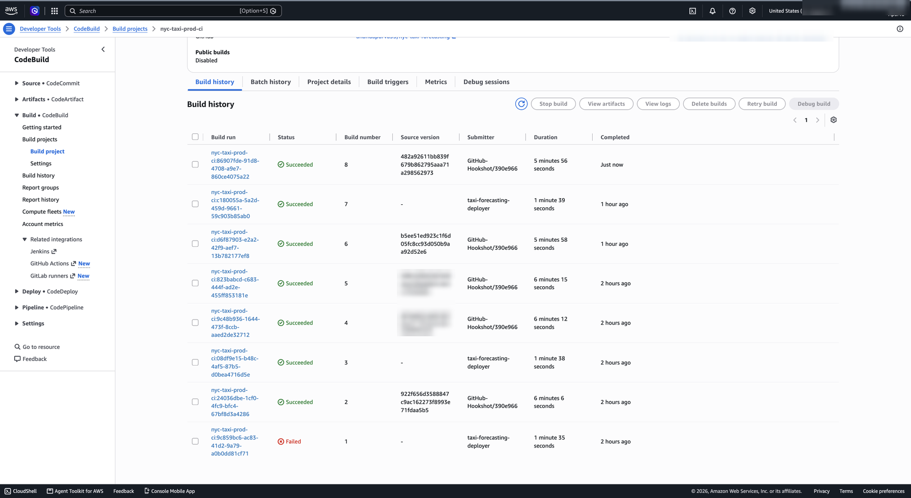 **CodeBuild build history:** webhook builds per commit, all succeeded after the first gate failure | 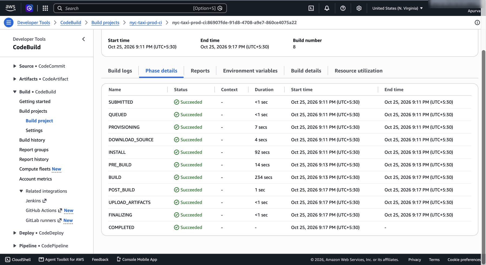 **CodeBuild phases:** install, quality gate, Docker build and ECS update |
| 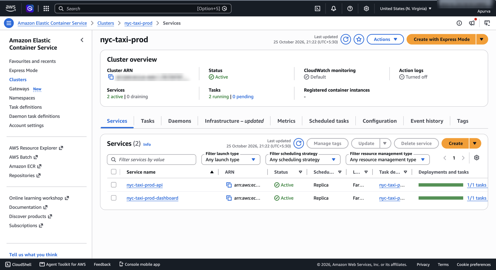 **Amazon ECS:** API and dashboard services, 1 of 1 tasks each | 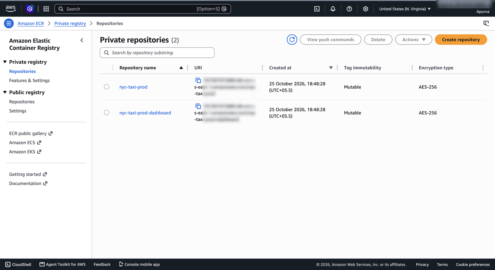 **Amazon ECR:** API and dashboard image repositories, AES-256 encrypted |

---

## Monitoring and drift detection

Captures every live prediction asynchronously through **CloudWatch Logs**, a subscription filter and **Amazon Data Firehose** into S3, then runs a weekly **Amazon SageMaker Processing** job that scores feature drift with **PSI** and **Kolmogorov-Smirnov** tests, publishes **CloudWatch** metrics and raises an alarm through **Amazon SNS**.

1. The API writes one JSON line per prediction to standard output ([src/monitoring/capture.py](src/monitoring/capture.py)).
2. **ECS** sends that output to **CloudWatch Logs**. A **subscription filter** forwards prediction events to **Amazon Data Firehose**, which compresses them and writes them to the **S3 monitoring bucket** under `captured/`.
3. **EventBridge Scheduler** starts a **SageMaker Processing job** every week. It runs [scripts/monitoring/run_drift_job.py](scripts/monitoring/run_drift_job.py) in the image from [docker/Dockerfile.monitoring](docker/Dockerfile.monitoring).
4. The job compares captured inputs with the training distribution using the **Population Stability Index (PSI)** and the **Kolmogorov-Smirnov (KS)** test ([src/monitoring/drift.py](src/monitoring/drift.py)). A feature drifts when its PSI is above **0.2**.
5. The job writes `drift_metrics.json` to S3 and publishes `FeaturesDrifted` to **CloudWatch**. An alarm on that metric emails the team through **SNS**. A second alarm watches API 5xx errors.

**Commands.** [scripts/aws/replay_traffic.py](scripts/aws/replay_traffic.py) sends real held-out February trips through the live API. The `--distance-factor` option multiplies trip distances to simulate a real change in traffic.

```bash
.venv/bin/python -m scripts.aws.replay_traffic --api-url "$API_URL" --rows 1000
.venv/bin/python -m scripts.aws.replay_traffic --api-url "$API_URL" --rows 1000 --distance-factor 3
```

**Firehose** delivers the captured requests within 5 minutes. The drift job then runs on its weekly schedule, or on demand from the schedule's own job definition.

**Results**

| Run | Traffic | Records | Features drifted | Outcome |
|---|---|---|---|---|
| Real traffic | 1,000 random test-split trips | 997 | 0 of 5 (largest PSI 0.019) | `FeaturesDrifted = 0`, alarm **OK** |
| Shifted traffic | Same trips, distance x 3 | 996 | 1 of 5: `trip_distance`, PSI **1.90** | `FeaturesDrifted = 1`, alarm **ALARM**, email delivered |

```text
INFO Drift: 1/5 features drifted (share=0.20) -> drifted=True
INFO Published 6 metrics to CloudWatch namespace TaxiForecasting/Drift
ALARM  Threshold Crossed: 1 datapoint [1.0] was greater than or equal to the threshold (1.0).
```

Only `trip_distance` was flagged. The four unchanged features stayed below a **PSI** of 0.02, so the alert points straight at what changed.

An offline drift drill, [scripts/monitoring/demo_drift_report.py](scripts/monitoring/demo_drift_report.py), checks every model feature without AWS. It flagged `lag_3` and `lag_168` (**PSI** 13.66 and 13.65) out of 20 demand features and `PULocationID` and `DOLocationID` (PSI 8.57 and 8.89) out of 14 fare features, exactly the features it shifted.

**In the AWS console.** **SageMaker** lists every drift run, **CloudWatch** shows the drift alarm firing beside the healthy API error alarm, and **SNS** delivered the alert email. The two failed SageMaker runs are the region and exit-code issues described in [Issues found and fixed](#issues-found-and-fixed); the reruns after each fix completed. Account identifiers are blurred.

| | |
|---|---|
| 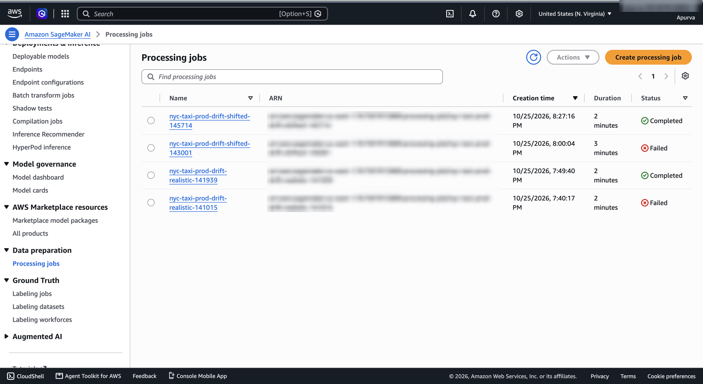 **SageMaker Processing:** drift runs on real and shifted traffic | 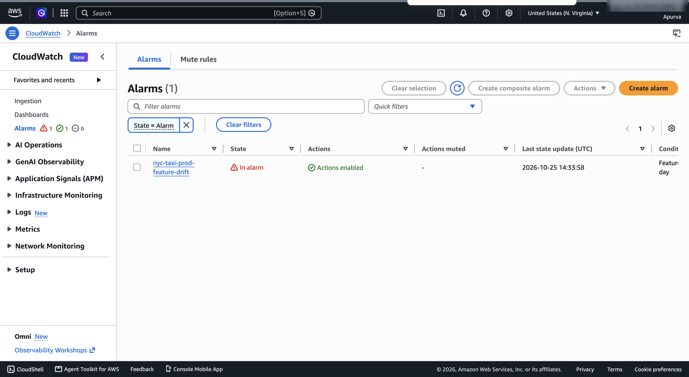 **CloudWatch alarm:** `nyc-taxi-prod-feature-drift` in alarm |
| 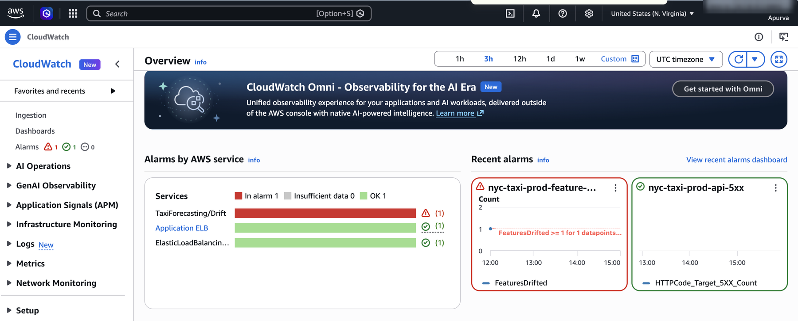 **CloudWatch overview:** drift metric crossing its threshold, API 5xx alarm OK | 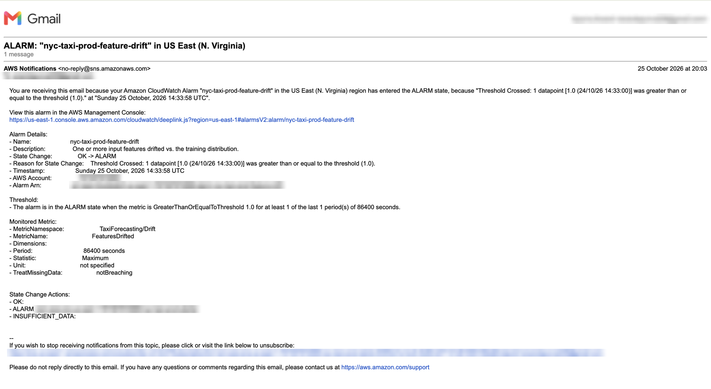 **SNS alert email:** state change OK to ALARM |

---

## Responsible AI

Explains individual predictions with **SHAP** **TreeExplainer**, audits test-set error across borough, time of day, day type, holiday and airport subgroups, and publishes the reports to a versioned S3 data lake with object metadata that links each file to its Git commit.

**SHAP** assigns each feature a signed contribution to a prediction. The API explains single predictions at `/explain/fare` and `/explain/demand`. The subgroup analysis ([src/responsible/fairness.py](src/responsible/fairness.py)) splits test errors by borough, time of day, day type, holiday and airport trips, and flags any dimension where the worst group's RMSE is more than **1.5 times** the best group's. SHAP shows how the model uses its inputs. It does not prove cause and effect.

**Commands**

```bash
.venv/bin/python -m scripts.responsible.run_analysis
bash scripts/aws/publish_fairness_evidence.sh
```

**Results: what drives the models.** Global **SHAP** summaries from the registered models. Each dot is one prediction: its position shows how much a feature pushed that prediction up or down, and its colour shows whether the feature value was high (red) or low (blue).

| Fare model (LightGBM) | Demand model (XGBoost) |
|---|---|
| 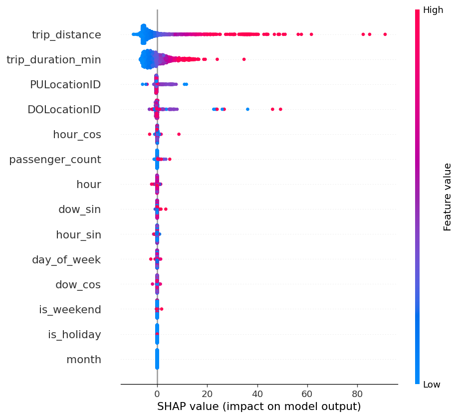 | 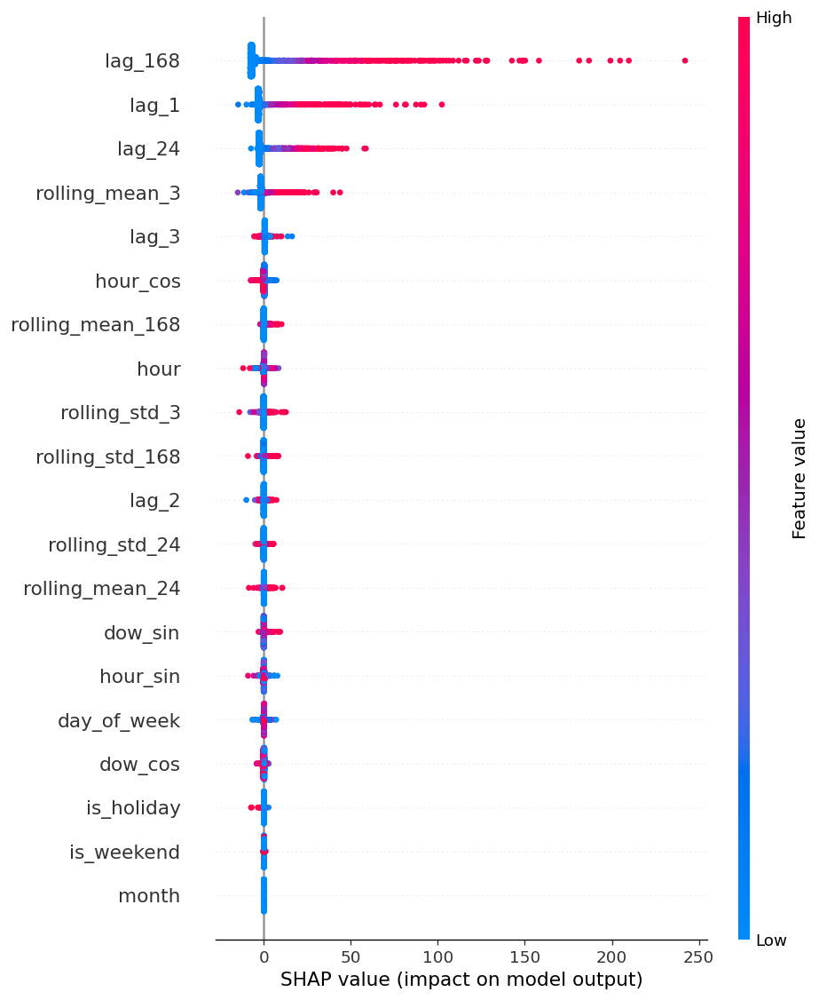 |
| `trip_distance` dominates: long trips add up to about $90 to the fare. `trip_duration_min` comes second, and some drop-off zones add $20 to $50. Calendar features barely move the fare. | `lag_168`, the same hour one week earlier, is the strongest feature, ahead of the previous hour (`lag_1`) and the same hour yesterday (`lag_24`). The model has learned the weekly rhythm of the city. |

`month` has no effect in either model because the training data covers a single month.

**A single prediction explained.** The deployed API explained a 17-mile trip from JFK Airport (zone 132) to Times Square (zone 230) at 18:30 on 27 February 2024. The model's base value of **$18.22** plus the contributions of every feature adds up exactly to the predicted fare of **$70.25**: distance adds $34.15, duration $12.79 and the JFK pickup zone $5.59.

<details>
<summary><code>POST /explain/fare</code> response recorded on AWS, values rounded to cents (click here to expand)</summary>

```json
{
  "problem": "fare",
  "prediction": 70.25,
  "base_value": 18.22,
  "contributions": [
    {
      "feature": "trip_distance",
      "value": 34.15
    },
    {
      "feature": "trip_duration_min",
      "value": 12.79
    },
    {
      "feature": "PULocationID",
      "value": 5.59
    },
    {
      "feature": "DOLocationID",
      "value": -0.25
    },
    {
      "feature": "hour_cos",
      "value": -0.08
    },
    {
      "feature": "passenger_count",
      "value": -0.07
    },
    {
      "feature": "hour",
      "value": -0.07
    },
    {
      "feature": "dow_sin",
      "value": -0.05
    },
    {
      "feature": "hour_sin",
      "value": 0.04
    },
    {
      "feature": "dow_cos",
      "value": -0.03
    },
    {
      "feature": "day_of_week",
      "value": 0.01
    },
    {
      "feature": "is_holiday",
      "value": 0.0
    },
    {
      "feature": "is_weekend",
      "value": -0.0
    },
    {
      "feature": "month",
      "value": 0.0
    }
  ]
}
```

</details>

**Results: subgroup audit.**

| Problem | Dimension | Worst group | Best group | Finding |
|---|---|---|---|---|
| Demand | Borough | Manhattan (RMSE 17.13) | Staten Island | Busy zones have much larger absolute errors because they have much larger counts |
| Demand | Time of day | Evening (RMSE 13.00) | Overnight (RMSE 2.85) | Evening peaks are the hardest hours to predict |
| Demand | Airport | Airport zones (RMSE 35.10, n = 106) | Other zones (RMSE 8.86) | Airport demand follows flight schedules the model does not see |
| Fare | Borough | Unknown zone (RMSE 12.12) | Manhattan (RMSE 2.09) | Trips without a valid zone are the least reliable |
| Fare | Airport | Airport trips (RMSE 7.50) | Other trips (RMSE 2.67) | Flat airport fares, tolls and long distances widen errors |

| Gap | Action | Success measure |
|---|---|---|
| Airport demand | Add flight arrival counts as a feature | Airport RMSE ratio below 2.0 |
| Airport fares | Add a JFK flat-fare indicator and toll zone features | Airport fare RMSE below $5.00 |
| Unknown zones | Route unknown zones to a fallback estimate labelled as low confidence | Zero unlabelled predictions for unknown zones |

The evidence script publishes the subgroup reports, **SHAP** summaries and model cards to the versioned S3 data lake under a stable `latest/` key and an immutable timestamped key. Every object carries metadata with the problem, evidence type and Git commit, and receives an S3 version ID. Model cards are in [docs/model_cards/](docs/model_cards/).

**In the AWS console.** Each evidence file sits under a timestamped key in the versioned data lake and carries its own S3 version ID. Account identifiers are blurred.

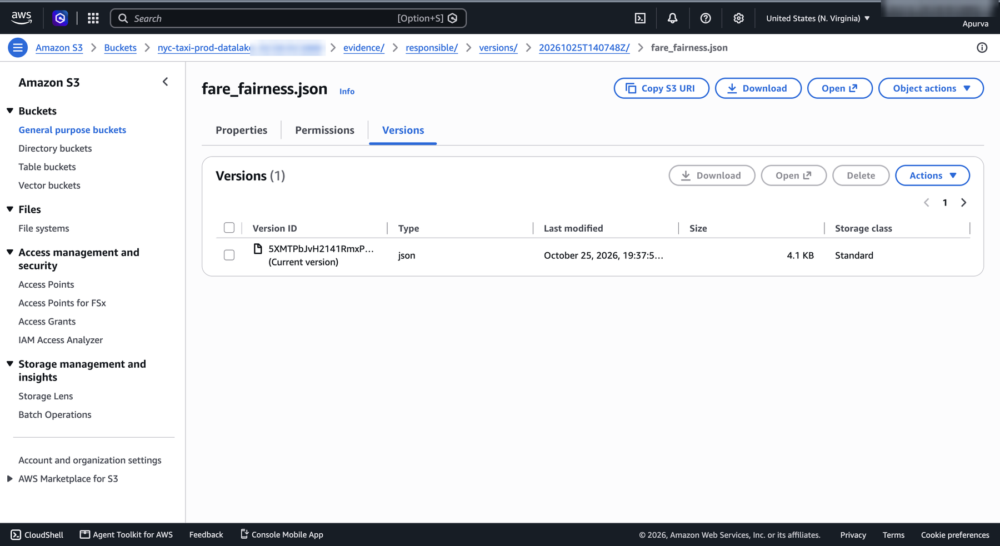

---

## Dashboard

A **Streamlit** application running as its own **ECS** **Fargate** service behind its own load balancer. It calls the live API for predictions, forecasts and **SHAP** explanations, and renders the model cards, subgroup reports and drift reports with **Plotly**.

| Page | Shows |
|---|---|
| Overview | Live API health and headline model quality |
| Demand forecast | Recursive forecast for selected zones, charted by hour and totalled by zone |
| Fare prediction | Live fare prediction with its SHAP breakdown |
| Explainability | SHAP contributions for a single demand prediction |
| Responsible AI | Subgroup error tables and global SHAP plots for each model |
| Monitoring and KPIs | Next-hour demand by borough, top zones and the drift drill report with PSI, KS and flags |

**Commands**

```bash
.venv/bin/python -m pip install -r requirements-dashboard.txt
API_BASE_URL=http://127.0.0.1:8000 .venv/bin/python -m streamlit run dashboard/app.py --server.port 8501
```

On AWS the dashboard runs as its own **ECS** service behind its own load balancer and calls the API load balancer.

**Results.** Screenshots taken from the AWS deployment.

| | |
|---|---|
| 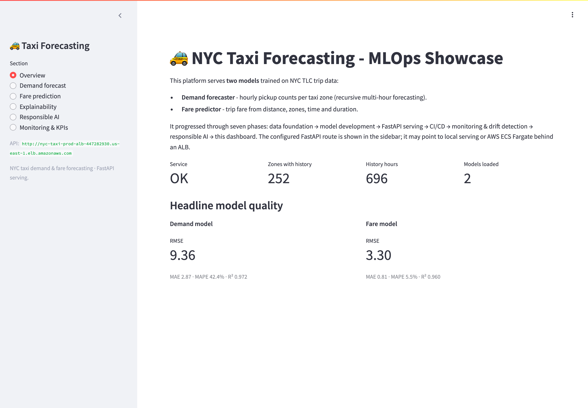 **Overview** | 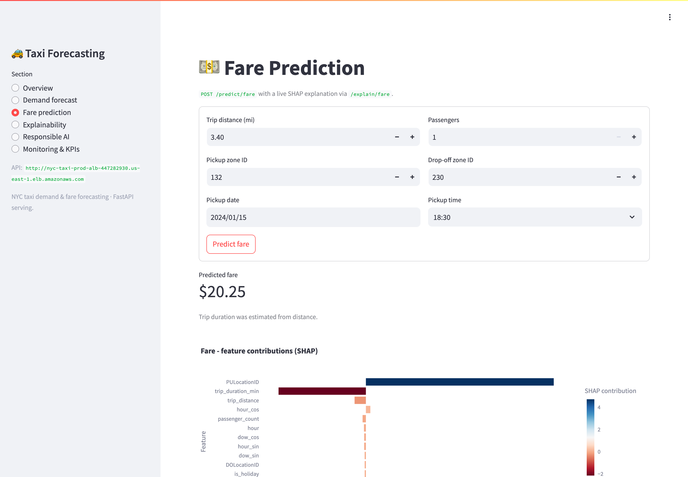 **Fare prediction** |
| 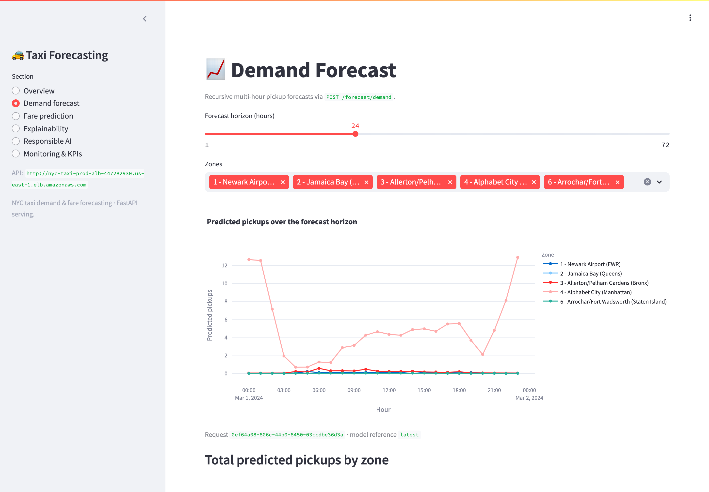 **Demand forecast** | 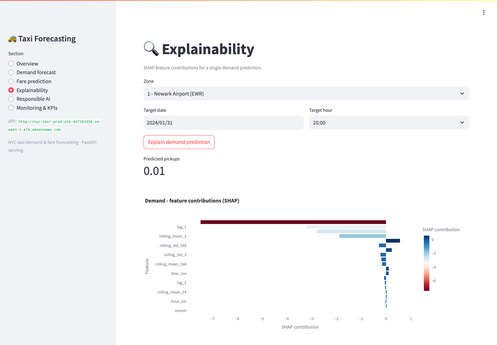 **Explainability** |
| 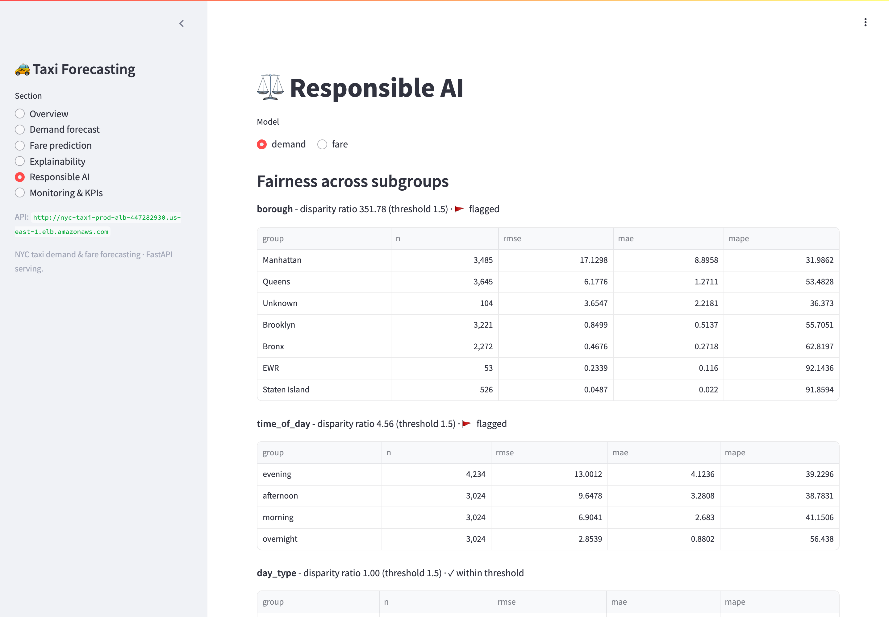 **Responsible AI** | 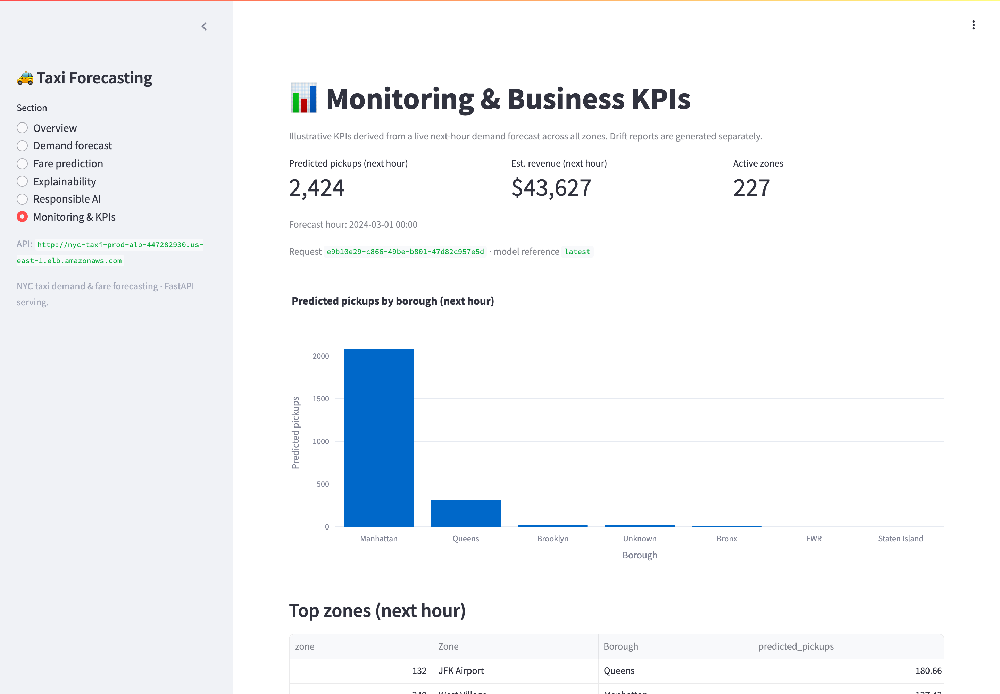 **Monitoring and KPIs** |

---

## Reproducible golden path

A single Bash entry point rebuilds the whole project from a new, empty copy of the repository and verifies every stage, from environment setup to drift detection.

[scripts/golden_path.sh](scripts/golden_path.sh) runs 11 stages in order, writes one log per stage to `logs/golden_path/`, stops at the first failure and records the commit, timings and status of every stage in `logs/golden_path/summary.json`.

**Commands**

```bash
bash scripts/golden_path.sh
```

**Results.** Run on a new, empty copy of the repository downloaded from **GitHub** at commit `482a926`, with no data, models or environment carried over: **11 of 11 stages passed in 5 minutes 26 seconds.**

<details>
<summary>Stage-by-stage result (click here to expand)</summary>

| Stage | What it proves | Status | Seconds |
|---|---|---|---|
| 01 environment | Python 3.11 environment builds from `requirements.txt` | ok | 35 |
| 02 lint | Ruff passes | ok | 1 |
| 03 tests | All unit and integration tests pass | ok | 37 |
| 04 data pipeline | February 2024 data downloads, cleans and splits | ok | 9 |
| 05 pipeline outputs | Summary, demand history and all six split files exist | ok | 0 |
| 06 train and register | Both problems tune, train and register a winner | ok | 193 |
| 07 batch inference | Recursive forecasts are written to `predictions.db` | ok | 8 |
| 08 API smoke test | API starts, `/health` is ok, every endpoint passes, invalid input is rejected | ok | 6 |
| 09 responsible AI | SHAP and subgroup reports and model cards are written | ok | 27 |
| 10 drift report | Drift detection flags the shifted features | ok | 10 |
| 11 final outputs | Every expected artifact exists | ok | 0 |
| **Total** | | **11 of 11** | **326 (5 min 26 s)** |

</details>

---

## Issues found and fixed

Real problems found while building and deploying this system, and how each was resolved.

| # | Symptom | Cause | Fix | Proof |
|---|---|---|---|---|
| 1 | `pip install` failed building LightGBM on macOS | The OpenMP runtime `libomp` was missing, so LightGBM compiled from source and failed to link | Installed `libomp` with Homebrew | LightGBM 4.3.0 and XGBoost 2.0.3 import and train |
| 2 | An MLflow test failed with `ImportError: FallbackAsyncAdaptedQueuePool` | SQLAlchemy 2.1 removed a class MLflow 2.14 imports, and SQLAlchemy was not pinned | Pinned `sqlalchemy<2.1` | All tests pass locally and in CodeBuild |
| 3 | The first CodeBuild release stopped at `PRE_BUILD` | Ruff rule `I001`: unsorted imports | Sorted the imports and pushed; the webhook started a new build | The gate blocked the commit before any image was built, and the next build succeeded |
| 4 | No image existed for the SageMaker drift job | The job needs the code, `boto3` and the training split as its reference | Added `docker/Dockerfile.monitoring` with its own build context | SageMaker runs the job from this image |
| 5 | Load-test p95 was 726 ms against a 500 ms target | Every request opened a new TCP connection, paying an extra network round trip | Reused HTTP connections in the load test and the dashboard client | p95 dropped to 402 ms (fare) and 291 ms (demand) |
| 6 | The AWS drift job silently skipped pickup and drop-off zones | Captured requests use API names (`pu_location_id`), the reference uses training names (`PULocationID`) | Mapped captured names to feature names, with a unit test | Zone features appear in every drift report |
| 7 | The drift job failed with `NoRegionError`, so the drift alarm could never fire | SageMaker Processing containers start without an AWS region, which CloudWatch needs | Set `AWS_DEFAULT_REGION` in the Terraform job definition | Metrics published and the alarm fired on shifted traffic |
| 8 | The `--fail-on-drift` flag could never be turned off, and every drift finding showed as a failed SageMaker job | The flag used `store_true` with a default of `True` | Switched to an on and off flag pair and pass `--no-fail-on-drift` on schedule, with a unit test | Drift runs now complete successfully and report drift through the alarm |
| 9 | The dashboard fare form defaulted to 15 January 2024 | The default predated the February 2024 model | Set February 2024 defaults | Screenshots show 27 February 2024 |

---

## Security

- **One IAM role per service.** The **ECS** task, **CodeBuild**, **Firehose**, the CloudWatch-to-Firehose subscription, **SageMaker** and **EventBridge Scheduler** each run under their own role.
- **Private by default.** Every S3 bucket blocks public access, and each container accepts traffic only from its own load balancer's security group.
- **Image scanning.** Both **ECR** repositories scan every image for known vulnerabilities on push.
- **No secrets in Git.** AWS access uses a dedicated **IAM** user through a local CLI profile. The **GitHub** token is read from a git-ignored file into a `sensitive` **Terraform** variable. Terraform state, variable files and plan files are git-ignored.

---

## Cost

While running, the stack costs about **$4.50 per day**: two load balancers, the API task (1 vCPU, 2 GB), the dashboard task (0.5 vCPU, 1 GB) and their public IP addresses. **SageMaker** is billed only for the minutes each drift job runs, and logs, S3, **Firehose** and alarms cost a few cents. The whole stack is created and removed with **Terraform**, so `terraform destroy` stops all charges. That is how this deployment was shut down after verification.

---

## What I would build next

1. **HTTPS** with AWS Certificate Manager on both load balancers.
2. **Commit-tagged images with blue-green deployments** through CodeDeploy, so every release can roll back to an exact previous commit.
3. **Gated automatic retraining** on each new month of data: retrain, compare against the live model on the same validation window, and promote only if it wins.
4. **Training on several months** to cover seasonality and holidays.
5. **A region closer to users**, such as `ap-south-1` (Mumbai), to cut network latency.

---

## Limitations

1. The models are trained on one month of Yellow Taxi data (February 2024). Seasonal effects, holidays outside that month and other taxi types are not covered.
2. The test window is the final days of February 2024, which are all weekdays, so weekend and holiday accuracy is not measured on test.
3. The fare model predicts `fare_amount` only. Tips, tolls, surcharges and the total bill are not predicted.
4. Forecasts start after the last stored hour of history, not from the current clock time.
5. Captured requests carry the fields a client sends, so the AWS drift job checks 5 fare inputs. Derived features such as lags are checked by the offline drift drill.
6. The API is served over HTTP on port 80 without TLS.

---

## Repository layout

| Path | Contents |
|---|---|
| `src/data/`, `src/features/` | Ingestion, validation, aggregation, feature engineering, time splits |
| `src/models/` | Tuning, training, evaluation, SHAP, model cards, registry |
| `src/serving/` | FastAPI app, schemas, inference service, batch forecasting |
| `src/monitoring/` | Prediction capture, drift detection, performance comparison |
| `src/responsible/` | Subgroup error analysis and explainability |
| `scripts/` | Command entry points, including `golden_path.sh` and the AWS scripts |
| `dashboard/` | Streamlit dashboard |
| `docker/` | API, dashboard and monitoring Dockerfiles, Compose file |
| `infra/terraform/` | All AWS infrastructure |
| `retraining/` | SageMaker pipeline definition for gated retraining |
| `tests/` | 122 unit and integration tests on synthetic data |
| `notebooks/` | Data exploration notebook |
| `docs/` | Diagrams, API examples, data statement, model cards |
