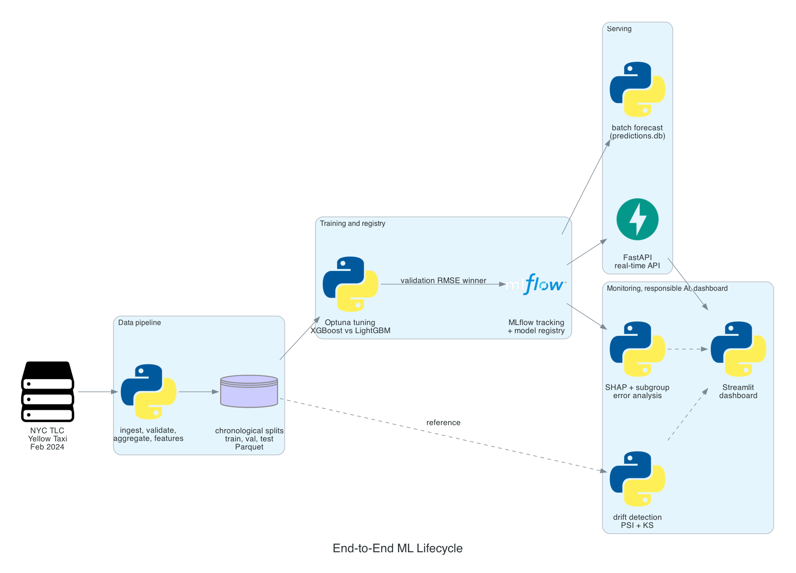
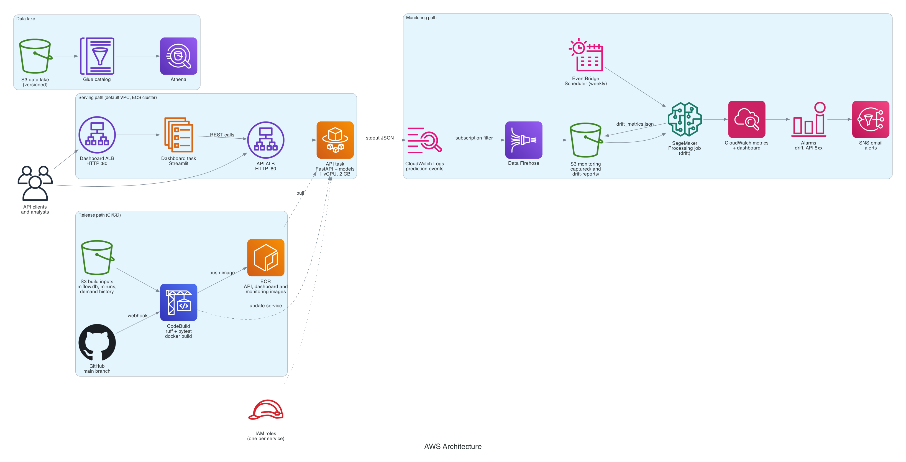
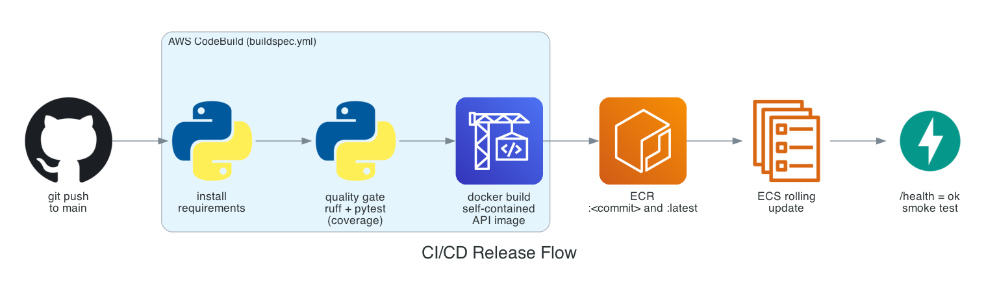
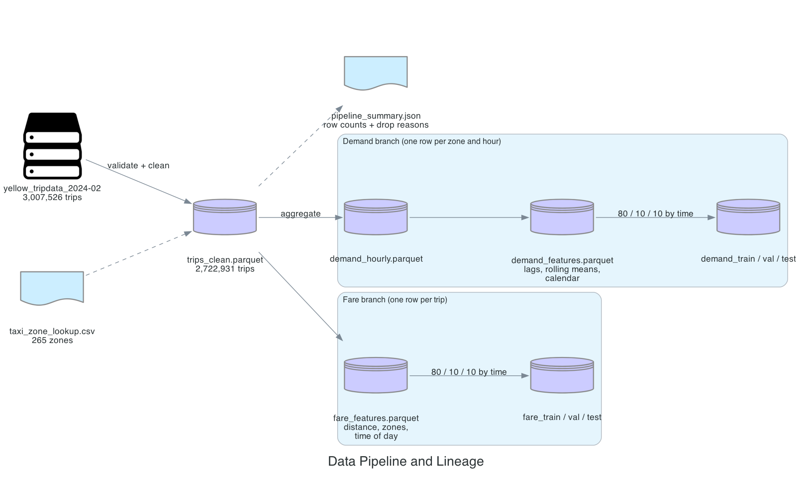

# NYC Taxi Forecasting: End-to-End MLOps on AWS

A production-style machine learning system that answers two questions for New York City yellow taxis:

1. **Demand forecasting:** how many pickups will a taxi zone get in a given hour?
2. **Fare prediction:** what will the base fare (`fare_amount`) be for a single trip?

The project covers the full lifecycle. It downloads public trip data, cleans it, builds features, trains and tunes two model families, tracks every run in MLflow, serves predictions through a FastAPI service, packages that service with Docker, deploys it to AWS ECS Fargate with Terraform, releases every change through AWS CodeBuild, captures live predictions for drift monitoring with SageMaker, explains and audits the models with SHAP and subgroup error analysis, and presents everything in a Streamlit dashboard.

---

## Table of contents

1. [Results at a glance](#results-at-a-glance)
2. [Architecture](#architecture)
3. [Dataset](#dataset)
4. [Phase 1: Data pipeline](#phase-1-data-pipeline)
5. [Phase 2: Model training and registry](#phase-2-model-training-and-registry)
6. [Phase 3: Model serving](#phase-3-model-serving)
7. [Phase 4: CI/CD and infrastructure](#phase-4-cicd-and-infrastructure)
8. [Phase 5: Monitoring and drift detection](#phase-5-monitoring-and-drift-detection)
9. [Phase 6: Responsible AI](#phase-6-responsible-ai)
10. [Phase 7: Dashboard](#phase-7-dashboard)
11. [Phase 8: Golden path (one command, clean start)](#phase-8-golden-path-one-command-clean-start)
12. [Live deployment](#live-deployment)
13. [Run it yourself](#run-it-yourself)
14. [Deploy to AWS](#deploy-to-aws)
15. [API reference](#api-reference)
16. [Repository layout](#repository-layout)
17. [Tech stack](#tech-stack)
18. [Limitations](#limitations)

---

## Results at a glance

All numbers come from the February 2024 run. Models are selected on the **validation** set and reported on the **test** set, which the selection step never sees.

| Problem | Winning model | Test RMSE | Test MAE | Test R² |
|---|---|---|---|---|
| Demand (pickups per zone per hour) | XGBoost | 9.36 pickups | 2.87 pickups | 0.972 |
| Fare (`fare_amount` per trip) | LightGBM | $3.30 | $0.81 | 0.960 |

| Stage | Outcome |
|---|---|
| Raw trips downloaded | 3,007,526 |
| Clean trips after validation | 2,722,931 (90.5% kept) |
| Demand rows (zone x hour) | 133,056 |
| Unit and integration tests | 120 passing |
| Lint (Ruff) | clean |
| Drift check (synthetic shift) | 2 of 20 demand features and 2 of 14 fare features flagged |
| Subgroup audit | Largest gaps found for airport trips and the Manhattan demand zones |

---

## Architecture

### End-to-end ML lifecycle



### AWS architecture



The AWS design separates three responsibilities:

| Path | Question it answers | Services |
|---|---|---|
| **Serving path** | Who answers the customer? | Application Load Balancer, ECS service, Fargate task running FastAPI with the models loaded in memory |
| **Release path** | Who ships a change? | GitHub webhook, CodeBuild (lint, tests, Docker build), ECR, ECS rolling update |
| **Evidence path** | Who records what happened? | CloudWatch Logs, subscription filter, Data Firehose, S3, EventBridge Scheduler, SageMaker Processing, CloudWatch alarms, SNS |

Each component has one job. ECR stores images and does not run them. ECS and Fargate run containers and do not build them. CodeBuild builds and tests and does not serve traffic. The model is loaded once when the container starts, so requests only run inference.

### CI/CD release flow



All diagrams are generated from code in [docs/diagrams/generate.py](docs/diagrams/generate.py) using the [`diagrams`](https://diagrams.mingrammer.com) library and the official AWS icon set.

---

## Dataset

| Item | Detail |
|---|---|
| Source | [NYC Taxi and Limousine Commission (TLC) trip records](https://www.nyc.gov/site/tlc/about/tlc-trip-record-data.page) |
| File | `yellow_tripdata_2024-02.parquet` (Yellow Taxi, February 2024) |
| Zone lookup | `taxi_zone_lookup.csv` (265 TLC zones with borough and service zone) |
| Size | 3,007,526 trips, 19 columns |
| Key columns | pickup and drop-off timestamps, pickup and drop-off zone IDs, trip distance, passenger count, fare amount |

The month is set in [config/config.yaml](config/config.yaml) (`tlc_year: 2024`, `tlc_month: 2`) and can be changed with `--year` and `--month` on the pipeline command.

**What one row means at each stage:**

| Stage | One row is |
|---|---|
| Raw and clean trips | one taxi trip |
| Demand table | one pickup zone in one hour, including hours with zero pickups |
| Fare table | one clean trip with its engineered features |

The dataset contains no rider names or demographic fields. Zones and boroughs are geographic groups, not personal attributes.

---

## Phase 1: Data pipeline



**Command:**

```bash
.venv/bin/python -m scripts.run_pipeline --year 2024 --month 2
```

**What happens, in order:**

1. **Ingest** ([src/data/ingestion.py](src/data/ingestion.py)): downloads the monthly Parquet file and the zone lookup CSV into `data/raw/`.
2. **Validate and clean** ([src/data/validation.py](src/data/validation.py)): enforces the schema and removes implausible records using the bounds in `config/config.yaml`.
3. **Aggregate** ([src/data/aggregation.py](src/data/aggregation.py)): turns trips into a dense zone by hour table of pickup counts.
4. **Engineer features** ([src/features/](src/features/)): demand gets calendar features, lags (1, 2, 3, 24 and 168 hours) and rolling means (3, 24 and 168 hours), all shifted so that only past values are used. Fare gets trip distance, trip duration, passenger count, pickup and drop-off zones and pickup time features.
5. **Split by time** ([src/data/splits.py](src/data/splits.py)): the first 80% of the timeline is training, the next 10% is validation and the last 10% is test. Splitting by time stops future information from leaking into training.
6. **Persist evidence:** every output is written as Parquet, and `data/processed/pipeline_summary.json` records row counts and the reason each row was dropped.

**Cleaning results (February 2024):**

| Rule | Rows removed |
|---|---|
| Passenger count outside 1 to 8 | 213,189 |
| Fare outside $0 to $500 | 35,776 |
| Trip duration outside 1 to 240 minutes | 35,545 |
| Trip distance outside 0 to 100 miles | 70 |
| Pickup outside February 2024 | 15 |
| **Total removed** | **284,595** |

A full visual walk-through of the raw data, every cleaning rule and both feature branches is in [notebooks/01_explore_dataset.ipynb](notebooks/01_explore_dataset.ipynb).

---

## Phase 2: Model training and registry

**Command:**

```bash
.venv/bin/python -m scripts.train_models --n-trials 5
```

**What happens:**

1. For each problem, **XGBoost** and **LightGBM** are tuned with **Optuna** (5 trials each). Optuna searches the number of trees, tree depth, learning rate, row and column sampling, minimum leaf size and L2 regularisation.
2. Every candidate is logged to **MLflow** with its parameters, validation metrics, test metrics and the model file.
3. The winner is the candidate with the **lowest validation RMSE**. This rule is fixed before training, and test scores are never used to choose.
4. The winner is registered in the **MLflow Model Registry** as `taxi-demand-forecaster` or `taxi-fare-predictor`.
5. SHAP plots and a model card are written for each winner.

**Candidate comparison:**

| Problem | Model | Validation RMSE | Test RMSE | Test R² | Selected |
|---|---|---|---|---|---|
| Demand | XGBoost | **10.387** | 9.361 | 0.972 | Yes |
| Demand | LightGBM | 10.400 | 9.207 | 0.973 | No |
| Fare | XGBoost | 4.017 | 3.634 | 0.952 | No |
| Fare | LightGBM | **3.730** | 3.305 | 0.960 | Yes |

For demand, LightGBM scores slightly better on test, but XGBoost won on validation, so XGBoost is the registered model. Changing the winner after looking at test results would turn the test set into a second validation set and remove its value as an unbiased final check.

**Inspect the runs:**

```bash
.venv/bin/python -m mlflow ui --backend-store-uri sqlite:///mlflow.db --host 127.0.0.1 --port 5000
```

Then open http://127.0.0.1:5000. The tracking store is `mlflow.db` (SQLite) and model files live in `mlruns/`.

---

## Phase 3: Model serving

### Real-time API

The FastAPI service in [src/serving/api.py](src/serving/api.py) loads both registered models and the demand history once at startup, then answers requests from memory.

```bash
.venv/bin/python -m uvicorn src.serving.api:app --host 127.0.0.1 --port 8000
```

Interactive documentation (Swagger UI) is served at `/docs`. The `/health` endpoint returns `status: ok` only when both models and the demand history are loaded, so a plain HTTP 200 is never treated as proof of readiness.

Every request is validated by Pydantic schemas in [src/serving/schemas.py](src/serving/schemas.py). Invalid input, such as a negative trip distance, returns HTTP 422 with a description of the problem.

### Batch inference

```bash
.venv/bin/python -m scripts.batch_forecast --horizon 3
```

This forecasts every zone for the next 3 hours after the last stored hour. Each hour's prediction becomes the lag input for the next hour (recursive forecasting). The February run wrote **756 forecasts (252 zones x 3 hours)** to the SQLite table in `predictions.db`.

### Docker

The API image in [docker/Dockerfile](docker/Dockerfile) is self-contained. It bakes in the code, the registered models, a portable copy of the MLflow registry and the demand history, so the container needs no external model store.

```bash
.venv/bin/python -m scripts.make_mlflow_portable --src mlflow.db --dest mlflow.container.db --new-base file:///app/mlruns
docker compose -f docker/docker-compose.yml up --build
```

---

## Phase 4: CI/CD and infrastructure

### Infrastructure as code

All AWS resources are defined in Terraform under [infra/terraform/](infra/terraform/):

| File | Resources |
|---|---|
| `main.tf` | ECR repository, ECS cluster, Fargate task definition and service, Application Load Balancer, security groups, CloudWatch log group, IAM task role |
| `cicd.tf` | CodeBuild project, GitHub source credential and webhook, S3 bucket for build inputs, CodeBuild IAM role |
| `monitoring.tf` | Firehose capture stream, S3 monitoring bucket, log subscription filter, SageMaker role, EventBridge Scheduler, CloudWatch alarms and dashboard, SNS email topic |
| `dashboard.tf` | Dashboard ECR repository, ECS service and its own load balancer |
| `datalake.tf` | Versioned S3 data lake, Glue catalog database, Athena workgroup |
| `resource_group.tf` | One AWS Resource Group that lists every resource of this project |

The API task runs with **1 vCPU and 2 GB of memory** in the default VPC behind an HTTP load balancer on port 80.

### Continuous integration and delivery

[buildspec.yml](buildspec.yml) defines the CodeBuild pipeline, which GitHub triggers through a webhook:

| Phase | Steps |
|---|---|
| install | Install Python dependencies |
| pre_build | `ruff check .` and `pytest` with coverage. A failure stops the build. |
| build | Download model artifacts from S3, create the portable registry, `docker build`, push the image to ECR as `latest` |
| post_build | Request an ECS rolling update to the new image |

Pushes to `main` build and deploy. Pull requests run the quality gate and never deploy. CodeBuild records the Git commit it built as the build's source version and reports the result back to GitHub, so every commit shows a pass or fail status and every image traces back to one commit.

---

## Phase 5: Monitoring and drift detection

**How live predictions are captured:**

1. The API writes one structured JSON line per prediction to standard output ([src/monitoring/capture.py](src/monitoring/capture.py)).
2. ECS ships that output to **CloudWatch Logs**.
3. A **subscription filter** selects prediction events and sends them to **Amazon Data Firehose**.
4. Firehose buffers, compresses and writes them to the **S3 monitoring bucket** under `captured/`.

**How drift is detected:**

1. **EventBridge Scheduler** starts a **SageMaker Processing job** every week. The job runs [scripts/monitoring/run_drift_job.py](scripts/monitoring/run_drift_job.py) in the monitoring image built from [docker/Dockerfile.monitoring](docker/Dockerfile.monitoring).
2. The job compares captured features against the training distribution using the **Population Stability Index (PSI)** and the **Kolmogorov-Smirnov (KS)** test ([src/monitoring/drift.py](src/monitoring/drift.py)).
3. A feature is flagged when its PSI is above **0.2**. KS adds supporting evidence.
4. The job writes `drift_metrics.json` to S3 and publishes `FeaturesDrifted` to **CloudWatch**.
5. A **CloudWatch alarm** on that metric sends an email through **SNS**. A second alarm watches API 5xx errors.

**Drift drill result.** [scripts/monitoring/demo_drift_report.py](scripts/monitoring/demo_drift_report.py) deliberately shifts two features to prove the detector works:

| Problem | Features checked | Flagged | PSI of flagged features |
|---|---|---|---|
| Demand | 20 | `lag_3`, `lag_168` | 13.66 and 13.65 |
| Fare | 14 | `PULocationID`, `DOLocationID` | 8.57 and 8.89 |

Every unshifted feature stayed below the threshold. A drift flag starts an investigation. It does not retrain or redeploy anything automatically, because a model change needs a fresh quality check first.

---

## Phase 6: Responsible AI

**Command:**

```bash
.venv/bin/python -m scripts.responsible.run_analysis
```

### Explainability (SHAP)

SHAP assigns each feature a signed contribution to a prediction. Global plots are in `artifacts/responsible/`, and the API explains single predictions at `/explain/fare` and `/explain/demand`. SHAP describes how the model uses its inputs. It does not prove cause and effect.

### Subgroup error analysis

A good average score can hide poor performance for a specific group. The analysis splits test errors by borough, time of day, day type, holiday and airport trips, and flags any dimension where the worst group's RMSE is more than **1.5 times** the best group's.

| Problem | Dimension | Worst group | Best group | Finding |
|---|---|---|---|---|
| Demand | Borough | Manhattan (RMSE 17.13) | Staten Island | Busy zones have far larger absolute errors because they have far larger counts |
| Demand | Time of day | Evening (RMSE 13.00) | Overnight (RMSE 2.85) | Evening peaks are the hardest hours to predict |
| Demand | Airport | Airport zones (RMSE 35.10, n = 106) | Other zones (RMSE 8.86) | Airport demand follows flight schedules the model does not see |
| Fare | Borough | Unknown zone (RMSE 12.12) | Manhattan (RMSE 2.09) | Trips without a valid zone are the least reliable |
| Fare | Airport | Airport trips (RMSE 7.50) | Other trips (RMSE 2.67) | Flat airport fares, tolls and long distances widen errors |

**Mitigation plan:**

| Gap | Action | Success measure |
|---|---|---|
| Airport demand | Add flight arrival counts as a feature | Airport RMSE ratio below 2.0 |
| Airport fares | Add a JFK flat-fare indicator and toll zone features | Airport fare RMSE below $5.00 |
| Unknown zones | Route predictions with unknown zones to a fallback estimate and label them as low confidence | Zero unlabelled predictions for unknown zones |

Model cards with intended use, metrics, subgroup results and limitations are in [docs/model_cards/](docs/model_cards/).

---

## Phase 7: Dashboard

The Streamlit dashboard in [dashboard/](dashboard/) calls the live API and reads the generated reports.

| Page | Shows |
|---|---|
| Overview | API health and headline model quality from the model cards |
| Demand Forecast | Recursive forecast for selected zones, charted by hour and totalled by zone |
| Fare Prediction | Live fare prediction for chosen zones, distance, passengers and pickup time |
| Explainability | SHAP contributions for a single live prediction |
| Responsible AI | Subgroup error tables and global SHAP plots for each model |
| Monitoring and Business KPIs | Top forecast zones for the next hour and the per-feature drift report with PSI, KS and flags |

```bash
.venv/bin/python -m pip install -r requirements-dashboard.txt
API_BASE_URL=http://127.0.0.1:8000 .venv/bin/python -m streamlit run dashboard/app.py --server.port 8501
```

On AWS the dashboard runs as its own ECS service behind its own load balancer and calls the API load balancer.

---

## Phase 8: Golden path (one command, clean start)

[scripts/golden_path.sh](scripts/golden_path.sh) runs the entire project from a fresh clone and checks every stage:

```bash
git clone https://github.com/anandapurva55/nyc-taxi-forecasting.git
cd nyc-taxi-forecasting
bash scripts/golden_path.sh
```

| Stage | What it proves |
|---|---|
| 01 environment | Python 3.11 virtual environment builds from `requirements.txt` |
| 02 lint | Ruff passes |
| 03 tests | All unit and integration tests pass |
| 04 data pipeline | February 2024 data downloads, cleans and splits |
| 05 pipeline outputs | Summary, demand history and all six split files exist |
| 06 train and register | Both problems tune, train and register a winner |
| 07 batch inference | Recursive forecasts are written to `predictions.db` |
| 08 API smoke test | The API starts, `/health` is ok, and every endpoint passes the contract check, including invalid input |
| 09 responsible AI | SHAP and subgroup reports and model cards are written |
| 10 drift report | Drift detection runs and flags the shifted features |
| 11 final outputs | Every expected artifact exists |

Each stage writes a log to `logs/golden_path/`, the run stops at the first failure, and `logs/golden_path/summary.json` records the commit ID, timings and status of every stage.

---

## Live deployment

| Component | Value |
|---|---|
| Region | `us-east-1` (US East, N. Virginia) |
| API | `http://<api-load-balancer>/docs` |
| Dashboard | `http://<dashboard-load-balancer>` |
| Release trigger | Push to `main` on this repository |

The deployment is created and removed with Terraform. Run `terraform -chdir=infra/terraform output` to print the current URLs.

---

## Run it yourself

### Prerequisites

| Tool | Version | Used for |
|---|---|---|
| Python | 3.11 (64-bit) | Everything |
| Git | any recent | Source control |
| Docker | 24 or newer | Container builds |
| Terraform | 1.5 or newer | AWS infrastructure |
| AWS CLI | v2 | AWS access |
| libomp | macOS only (`brew install libomp`) | XGBoost and LightGBM |

### Step by step

```bash
python3.11 -m venv .venv
.venv/bin/python -m pip install -r requirements.txt
.venv/bin/python -m pytest -q
.venv/bin/python -m ruff check .

.venv/bin/python -m scripts.run_pipeline --year 2024 --month 2
.venv/bin/python -m scripts.train_models --n-trials 5
.venv/bin/python -m scripts.batch_forecast --horizon 3
.venv/bin/python -m scripts.responsible.run_analysis
.venv/bin/python -m scripts.monitoring.demo_drift_report --problem all --mode drift

.venv/bin/python -m uvicorn src.serving.api:app --host 127.0.0.1 --port 8000
```

On Windows, replace `.venv/bin/python` with `.\.venv\Scripts\python.exe`.

---

## Deploy to AWS

The deployment uses an IAM user with its own CLI profile and a GitHub personal access token with the `repo` and `admin:repo_hook` scopes, so CodeBuild can clone the repository and register its webhook.

**1. Configure.** Create `infra/terraform/prod.tfvars` (it is git-ignored):

```hcl
aws_region        = "us-east-1"
project_name      = "nyc-taxi"
environment       = "prod"
task_cpu          = 1024
task_memory       = 2048
enable_cicd       = true
github_repo_url   = "https://github.com/<you>/nyc-taxi-forecasting.git"
enable_monitoring = true
alert_email       = "<you>@example.com"
enable_datalake   = true
enable_athena     = true
enable_dashboard  = true
```

**2. Bootstrap with zero running tasks.** ECS needs an image before it can start, and the image is built by CodeBuild, which Terraform creates. The first apply therefore starts the services at zero tasks:

```bash
export AWS_PROFILE=taxi
export TF_VAR_github_token="$(cat .secrets/github_token)"
terraform -chdir=infra/terraform init
terraform -chdir=infra/terraform apply -var-file=prod.tfvars -var desired_count=0 -var dashboard_desired_count=0
```

**3. Upload the model artifacts** that CodeBuild bakes into the image:

```bash
BUCKET=$(terraform -chdir=infra/terraform output -raw cicd_artifacts_bucket)
aws s3 cp mlflow.db "s3://$BUCKET/mlflow.db"
aws s3 sync mlruns "s3://$BUCKET/mlruns"
aws s3 cp data/processed/demand_hourly.parquet "s3://$BUCKET/demand_hourly.parquet"
```

**4. Build and push the images.** Start the API build in CodeBuild, then build the dashboard with `buildspec-dashboard.yml` and push the monitoring image from `docker/Dockerfile.monitoring` to ECR.

**5. Scale up** with the monitoring image URI set:

```bash
terraform -chdir=infra/terraform apply -var-file=prod.tfvars -var monitoring_image_uri=<ecr-uri>:monitoring
```

**6. Verify:**

```bash
API_URL=$(terraform -chdir=infra/terraform output -raw api_url)
curl "$API_URL/health"
.venv/bin/python scripts/aws/verify_staging.py --api-url "$API_URL" --timeout 60
```

**7. Tear down** when finished:

```bash
terraform -chdir=infra/terraform destroy -var-file=prod.tfvars
```

---

## API reference

| Method | Path | Purpose |
|---|---|---|
| GET | `/health` | Readiness: model flags, history hours and zone count |
| POST | `/predict/fare` | Fare for one trip |
| POST | `/predict/demand` | Pickups for one zone and hour |
| POST | `/forecast/demand` | Recursive multi-hour forecast for many zones |
| POST | `/explain/fare` | SHAP contributions for one fare prediction |
| POST | `/explain/demand` | SHAP contributions for one demand prediction |
| GET | `/metrics` | Prometheus metrics |
| GET | `/docs` | Swagger UI |

**Fare prediction:**

```bash
curl -X POST "$API_URL/predict/fare" -H "Content-Type: application/json" -d '{
  "trip_distance": 3.4,
  "pu_location_id": 132,
  "do_location_id": 230,
  "passenger_count": 1,
  "pickup_datetime": "2024-02-27T18:30:00"
}'
```

**Recursive demand forecast:**

```bash
curl -X POST "$API_URL/forecast/demand" -H "Content-Type: application/json" -d '{
  "horizon_hours": 3,
  "zones": [132, 161, 230]
}'
```

**Invalid input (returns HTTP 422):**

```bash
curl -X POST "$API_URL/predict/fare" -H "Content-Type: application/json" -d '{
  "trip_distance": -5,
  "pu_location_id": 132,
  "do_location_id": 230,
  "pickup_datetime": "2024-02-27T18:30:00"
}'
```

More examples are in [docs/API_EXAMPLES.md](docs/API_EXAMPLES.md).

---

## Repository layout

| Path | Contents |
|---|---|
| `src/data/`, `src/features/` | Ingestion, validation, aggregation, feature engineering, time splits |
| `src/models/` | Tuning, training, evaluation, SHAP, model cards, registry |
| `src/serving/` | FastAPI app, schemas, inference service, batch forecasting |
| `src/monitoring/` | Prediction capture, drift detection, performance comparison |
| `src/responsible/` | Subgroup error analysis and explainability |
| `scripts/` | Command entry points, including `golden_path.sh` |
| `dashboard/` | Streamlit dashboard |
| `docker/` | API, dashboard and monitoring Dockerfiles, Compose file |
| `infra/terraform/` | All AWS infrastructure |
| `retraining/` | SageMaker pipeline definition for gated retraining |
| `tests/` | 120 offline unit and integration tests on synthetic data |
| `notebooks/` | Data exploration notebook |
| `docs/` | Architecture, API examples, data statement, model cards, diagrams |

---

## Tech stack

| Area | Tools |
|---|---|
| Data | pandas, PyArrow, Parquet |
| Modelling | XGBoost, LightGBM, scikit-learn, Optuna |
| Tracking and registry | MLflow |
| Explainability | SHAP |
| Serving | FastAPI, Pydantic, Uvicorn, Prometheus instrumentation |
| Packaging | Docker, Docker Compose |
| Infrastructure | Terraform, AWS (ECS Fargate, ALB, ECR, S3, CodeBuild, CloudWatch, Data Firehose, EventBridge Scheduler, SageMaker Processing, SNS, Glue, Athena, IAM) |
| Quality | pytest, pytest-cov, Ruff |
| Dashboard | Streamlit |

---

## Limitations

1. The models are trained on one month of Yellow Taxi data (February 2024). Seasonal effects, holidays outside that month and other taxi types are not covered.
2. The test window is the last days of February 2024, which are all weekdays, so weekend and holiday accuracy is not measured on test.
3. The fare model predicts `fare_amount` only. Tips, tolls, surcharges and the total bill are not predicted.
4. Forecasts start after the last stored hour of history, not from the current clock time.
5. The drift drill uses a deliberate synthetic shift to prove the detector. It is not evidence of real production drift.
6. The API is served over HTTP on port 80 without TLS.

See [docs/DATA_STATEMENT.md](docs/DATA_STATEMENT.md) for the full data scope.
